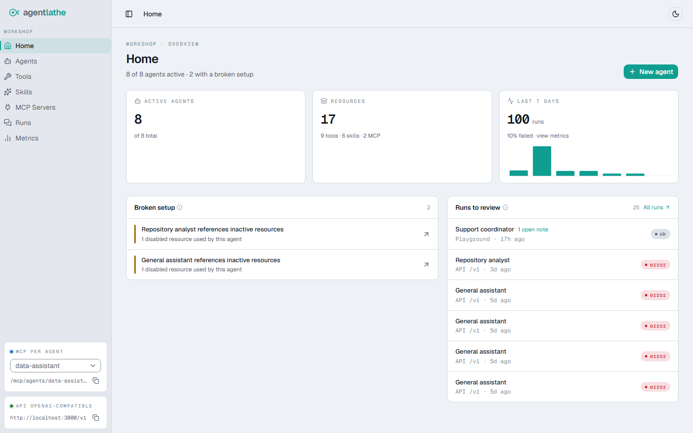
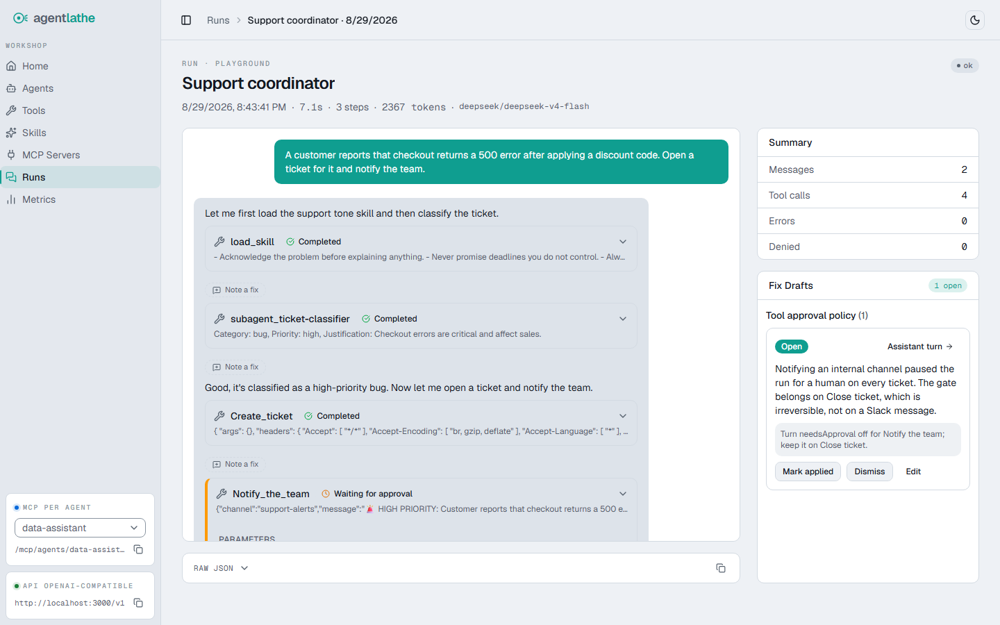
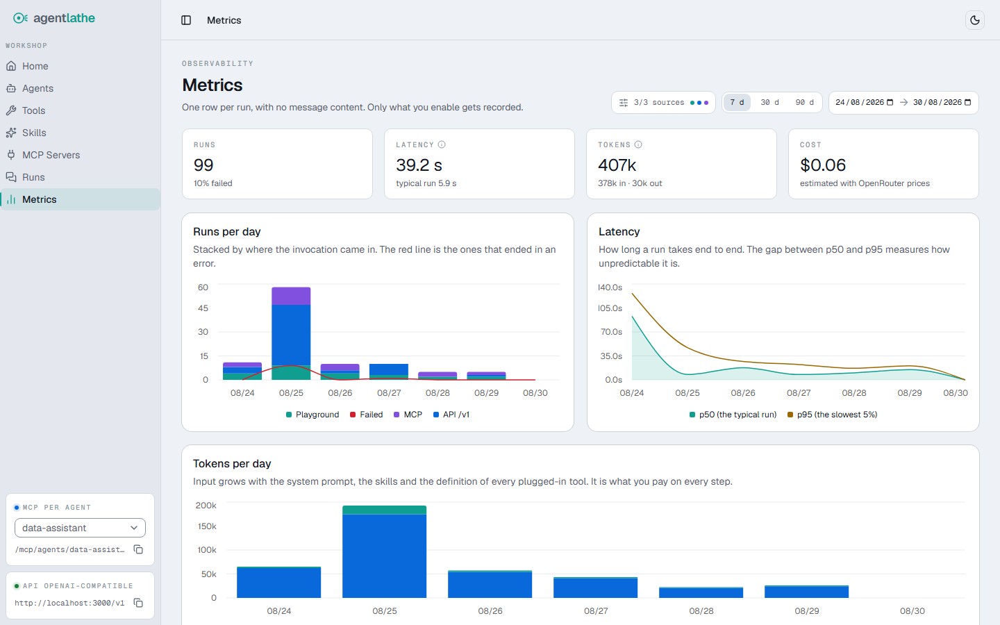

# agentlathe

[](https://github.com/contedenis/agentlathe/actions/workflows/ci.yml)
[](LICENSE)

> **Configure agents from a dashboard. Any OpenAI client can call them. Then review what they actually did.**

agentlathe is a self-hosted workshop for AI agents — no code required. Agents live in Postgres and are materialized at runtime as [AI SDK](https://ai-sdk.dev) `ToolLoopAgent`s, then exposed on three surfaces: an in-app chat (the Playground), an **OpenAI-compatible API** at `/v1`, and an **MCP endpoint per agent**. Every call becomes a **run** you can open, read and annotate, whatever client made it.

Models come from any **OpenAI-compatible provider**. The default is [OpenRouter](https://openrouter.ai) — one key, and an agent references any model in its catalog by slug (e.g. `anthropic/claude-opus-4.8`) — but `PROVIDER_BASE_URL` points the instance straight at OpenAI, Anthropic's OpenAI-compatible endpoint, or a local Ollama/LiteLLM/vLLM just as well.

<picture>
  <source media="(prefers-color-scheme: dark)" srcset="docs/images/home-dark.png">
  
</picture>

## What it's for, and what it isn't

**It's for** self-hosting a small agent platform where the review loop matters: you build an agent in a form, point clients at it, and then read the runs it produced to find out whether it is any good. Building the agent is the easy half; improving it on evidence rather than vibes is the half this tool is for.

**It is not** any of these, and the gap is deliberate:

- **No auth.** Single-tenant by design. The operator is expected to put a reverse proxy with authentication in front of it — see [Security model](#security-model-there-is-no-auth).
- **No evaluators.** You can note what went wrong on a run; nothing scores runs for you.
- **No memory.** Agents do not accumulate knowledge between runs.
- **No scheduling.** Nothing runs an agent for you on a timer or an event.

The last three are [ideas](#ideas), not commitments. Fix drafts — the notes you leave on a run — are the seed of the first two: they are where the evidence for an evaluator, and the raw material for memory, come from.

Reviewing a run is the half that is hard to do without a tool: what the agent loaded, which sub-agent it delegated to, what it called, what it stopped to ask permission for — and the note you leave on the exact turn that went wrong.

<picture>
  <source media="(prefers-color-scheme: dark)" srcset="docs/images/run-review-dark.png">
  
</picture>

One more thing that belongs up here: agentlathe is **built and maintained by one person**, best-effort, with no support channel — read [Project status](#project-status) before you build anything on it.

## Requirements

- **Node 22+** (`engines.node` is `>=22`; CI and the Docker images both run 22)
- **pnpm 10** (`packageManager` pins `pnpm@10.24.0`) — Node 22/24 ship Corepack, so `corepack enable` is enough; Node 25+ dropped it, install pnpm another way (e.g. `npm install -g pnpm`) instead
- **Postgres 16+**, or Docker if you let the compose stack provide it — Postgres is the only supported database
- An **API key for your model provider** — OpenRouter by default, or any OpenAI-compatible endpoint (OpenAI, Anthropic's compatibility endpoint, Ollama, LiteLLM, vLLM) pointed at with `PROVIDER_BASE_URL`

## Quickstart with Docker

The Docker engine must be running before anything below works. On **Windows/macOS**, start Docker Desktop first (or enable its start-on-login setting) — a `cannot connect to the Docker API` error means it isn't running. On **Linux**, the standard `docker-ce` install runs the engine as a system service, so there is nothing to start.

```bash
cp .env.example .env
# edit .env: set PROVIDER_API_KEY (required).

docker compose up --build
```

The dashboard is at **http://localhost:3000**.

Three services come up in order: `postgres` (with a health check), `migrator` (a one-shot container that applies the Drizzle migrations — idempotent — and exits), and `app` (which waits for postgres to be healthy *and* for the migrator to have completed successfully). Nothing else is required.

Compose also publishes Postgres on `127.0.0.1:5432` so host-side tools (`psql`, a GUI) can reach it. If you already run a Postgres on that port, `docker compose up` fails with a port conflict — change or remove the `ports` entry of the `postgres` service in `docker-compose.yml`; the containers talk to each other over the compose network and do not need it.

Seeding is optional. The `migrator` image carries the whole workspace, so run the seed scripts through it:

```bash
# one example agent, one skill, one HTTP tool
docker compose run --rm migrator pnpm --filter @agentlathe/db seed

# a fuller topology: 6 agents, 5 skills, 7 HTTP tools, sub-agents, an MCP server
docker compose run --rm migrator pnpm --filter @agentlathe/db seed:demo
```

Both are idempotent — they check for their marker agent (`General assistant` / `General orchestrator`) and do nothing if it exists. There is also `seed:runs`, which fabricates synthetic run metrics so the `/metrics` charts have something to draw; it makes no real model calls and is **not** idempotent.

The example tools they create point at a **public echo service** (httpbin.org / httpbingo.org) so the HTTP integration does something visible out of the box. If you chat with a seeded agent, whatever the model sends as tool input goes to a third party — swap those endpoints for your own before using the demo agents for anything real. The seeded model can be overridden with `SEED_MODEL`, which matters if you pointed `PROVIDER_BASE_URL` somewhere that does not serve OpenRouter's catalog — but compose does not forward `SEED_MODEL` from `.env` to the migrator, so pass it explicitly: `docker compose run --rm -e SEED_MODEL=... migrator pnpm --filter @agentlathe/db seed`.

The `app` container is the Next.js standalone output, without pnpm or the workspace source — so `docker compose exec app pnpm ...` will not work. Use `docker compose run --rm migrator` for anything that needs the toolchain.

To point at something other than OpenRouter, set `PROVIDER_BASE_URL` in `.env` (see `.env.example`) — compose forwards it to the app.

To stop the stack, `docker compose down`. That keeps the `postgres_data` volume, so your agents and runs survive a restart — which also means **it keeps the password Postgres was initialized with**: change `POSTGRES_PASSWORD` in `.env` after the first run and the app will fail to authenticate against a database that never saw the new value. To start clean, delete the volume too:

```bash
docker compose down -v   # drops the database along with the containers
```

Running without Docker, or in production: [docs/DEPLOYMENT.md](docs/DEPLOYMENT.md).

## Calling your agents

Every active agent is a model on the OpenAI-compatible API, addressable by the ID you picked in the agent form. If you ran the seed above, this works as-is:

```bash
curl http://localhost:3000/v1/chat/completions \
  -H "Content-Type: application/json" \
  -d '{
    "model": "general-assistant",
    "messages": [{ "role": "user", "content": "hi" }]
  }'
```

Each active agent is also its own MCP server at `POST /mcp/agents/{agent-id}`, exposing one tool. Point Claude Desktop, Cursor or any MCP client at it.

The full manual — building agents, HTTP tools, MCP servers, skills, sub-agents, metrics and fix drafts, plus both transport contracts — is in [docs/USAGE.md](docs/USAGE.md).

## Documentation

| File | What it covers |
|---|---|
| [docs/USAGE.md](docs/USAGE.md) | The manual: build agents, attach tools, call them, review the runs |
| [docs/DEPLOYMENT.md](docs/DEPLOYMENT.md) | Running without Docker, production deployment, reverse proxy, backups |
| [docs/ARCHITECTURE.md](docs/ARCHITECTURE.md) | Data model, the three transports, runner internals |
| [docs/DEVELOPING.md](docs/DEVELOPING.md) | Scripts, test levels, conventions |
| [SECURITY.md](SECURITY.md) | Accepted tradeoffs, deferred work, how to report a vulnerability |

## Recording and privacy

Two things get stored and they are governed separately: the **run** (one row of metadata, no message content) and the **transcript** (the actual messages). The default is that your own experiments are recorded and third-party traffic is not, until you switch it on per agent.

**Transcripts are stored verbatim. There is no redaction.** If a caller sends an API key or a customer's email in a message, that is what lands in your database, in plaintext. Turning on recording for an agent that serves real users is a decision about their data, not just yours.

The gates, the defaults and the retention TTLs are in [docs/USAGE.md](docs/USAGE.md#recording-and-privacy); the reasoning behind them, in [SECURITY.md](SECURITY.md).

What those rows add up to: how many runs came in through which transport, how many failed, how slow the typical one is against the slowest 5%, and what it cost.

<picture>
  <source media="(prefers-color-scheme: dark)" srcset="docs/images/metrics-dark.png">
  
</picture>

Separately: Next.js and Turborepo each phone home anonymous build telemetry by default. Docker and CI already disable both (`NEXT_TELEMETRY_DISABLED=1`, `TURBO_TELEMETRY_DISABLED=1`); set the same two variables yourself if you build or run scripts outside Docker.

## Security model: there is no auth

agentlathe is **single-tenant and has no authentication or authorization layer**. This is a deliberate scope decision, not an oversight. `docker-compose.yml` binds the app to `127.0.0.1` only, so it is not reachable from outside the host by default — but `pnpm dev` does not have that restriction.

**If you expose this beyond localhost, you are responsible for putting your own reverse proxy and/or authentication in front of it.** Do not bind agentlathe directly to a public interface without one. The operational details — the CSRF check, `APP_URL`, what to back up — are in [docs/DEPLOYMENT.md](docs/DEPLOYMENT.md); the known tradeoffs and [how to report a vulnerability](SECURITY.md#reporting-a-vulnerability), in [SECURITY.md](SECURITY.md).

## Architecture

Turborepo + pnpm workspaces monorepo:

```
apps/web/                Next.js 16 (App Router) — dashboard UI + API routes ("/api/*", "/v1/*", "/mcp/*")
packages/db/             Drizzle ORM schema, migrations, Postgres client, seed scripts
packages/openai-server/  The OpenAI Chat Completions wire format, in both directions: request parsing and (streaming) response serialization
packages/runner/         Agent runtime: builds a ToolLoopAgent from a DB-defined agent
```

Agents, tools, skills and MCP servers live in Postgres; `packages/runner` turns a DB row into a runnable agent on every request — nothing is pre-compiled per agent, so an edit in the dashboard takes effect on the next call. **The run is the durable unit**: there is no conversation table, because `/v1` is stateless by design, so a thread is just an optional `thread_id` grouping runs together.

Full walkthrough in [docs/ARCHITECTURE.md](docs/ARCHITECTURE.md).

## Project status

agentlathe is built and maintained by one person. It is open source because it is useful, not because it is staffed:

- **Issues and PRs are welcome but best-effort.** They may go unanswered or be closed without action, and there is no support channel.
- **No roadmap commitments.** The ideas below are a direction, not a schedule.
- **Security reports are the exception:** private vulnerability reports (see [SECURITY.md](SECURITY.md#reporting-a-vulnerability)) are always read.

The license is MIT — forking is a first-class option, not a last resort.

## Contributing

agentlathe has a single maintainer and no review commitments — read [CONTRIBUTING.md](CONTRIBUTING.md) before investing time in a pull request. To work on the code, see [docs/DEVELOPING.md](docs/DEVELOPING.md).

## Ideas

Where the design is headed, in the order each piece would unlock the next. No dates, no commitment — see [Project status](#project-status).

1. **Evaluators** — score a run automatically, so review scales past reading them one by one. Fix drafts are the labelled data this starts from.
2. **Memory** — let an agent carry what it learned across runs, instead of rebuilding context every call.
3. **Scheduling** — run agents on a timer or an event, not only when someone calls them.

Orthogonal to that chain: **native provider support**. Single-provider setups already connect directly — `PROVIDER_BASE_URL` + `PROVIDER_API_KEY` point the instance at OpenAI, Anthropic's OpenAI-compatible endpoint, or a local Ollama instead of OpenRouter. What remains is native support where a compatibility layer falls short (Anthropic's Messages API), and graceful handling of `/models` endpoints that lack OpenRouter's metadata (context limits, pricing).

## License

[MIT](LICENSE).
