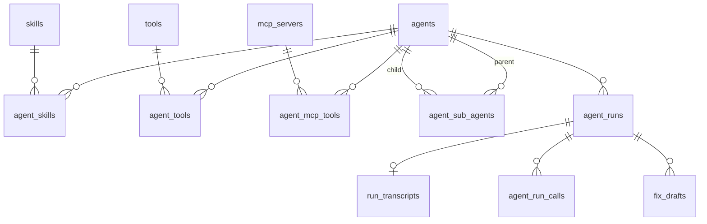

# Architecture

## Packages

Turborepo + pnpm-workspaces monorepo, four packages:

- **`apps/web`** — Next.js 16 App Router. Serves the dashboard UI, the `/api/*` CRUD routes, the public OpenAI-compatible surface under `/v1`, and the MCP endpoint under `/mcp/agents/[id]`.
- **`packages/db`** — Drizzle ORM schema, Postgres client, migrations (`drizzle/*.sql`), seed scripts.
- **`packages/runner`** — Builds an AI SDK 7 `ToolLoopAgent` from a DB-defined agent row. Nothing is precompiled per agent: `buildAgentRuntime` (`packages/runner/src/runtime.ts`) assembles tools, skills, approval strategy and stats collector fresh on every request.

- **`packages/openai-server`** — Translates between the OpenAI Chat Completions wire format and the AI SDK: a generate result into a blocking `chat.completion`, a `fullStream` into an SSE `Response` of `chat.completion.chunk` frames (including index-addressed `tool_calls` deltas), and an incoming OpenAI `messages` array back into `ModelMessage[]`. Depends on nothing in this repo — `ai` is a peer — because no such helper exists in the SDK and the problem is not specific to agentlathe.

`apps/web` depends on both `packages/db` and `packages/runner`. `packages/runner` depends on `packages/db` for the schema, naming helpers, and run-recording functions, and on `packages/openai-server` for the `/v1` serialization it re-exports.

Agents reference models by slug (the `agents.model` column) — an OpenRouter slug by default, or whatever slug the configured OpenAI-compatible endpoint serves. Multi-provider access goes through `@ai-sdk/openai-compatible` (`createOpenAICompatible` → `https://openrouter.ai/api/v1`), not `@openrouter/ai-sdk-provider`.

## Data model

Schema lives in `packages/db/src/schema.ts`. Thirteen tables: five entities, four run-record tables, four join tables.

**Entities**

- `agents` — `id`, `name` (unique), `slug` (unique — the human-chosen ID used by `/v1` and the MCP URL), `description`, `model`, `system_prompt`, `max_steps` (default 20), `is_active`, `record_traffic` (default false), timestamps.
- `skills` — `id`, `name`, `description`, `content`, `is_active`, timestamps.
- `tools` — `id`, `name`, `description`, `endpoint`, `input_schema` (jsonb), `needs_approval`, `is_active`, timestamps.
- `mcp_servers` — `id`, `name`, `server_url`, `auth_config` (jsonb, nullable), `is_active`, timestamps.
- `settings` — singleton row (`id` defaults to `"singleton"`), `track_dashboard_runs` (default true), `track_v1_runs` (default false), `track_mcp_runs` (default false), `agent_run_ttl_days` (default 90, CHECK `>= 0`), `transcript_ttl_days` (default 14, CHECK `>= 0`).

**Run records**

- `agent_runs` — one row per call from any transport. `agent_id` FK → `agents.id` ON DELETE CASCADE. `source` CHECK in `('dashboard','v1','mcp')`. `thread_id` (nullable text, no FK — there is no conversation table). `status` CHECK in `('ok','error')`. `model` (nullable text), `duration_ms`, `steps`, `tool_calls`, `input_tokens`, `output_tokens`, `approvals_requested`, `approvals_granted`, `mcp_failures` (nullable jsonb, list of servers whose tools were missing for the run — failed to connect, or connected without offering a selected tool), `error`. Indexes on `agent_id`, `created_at`, `source`, `thread_id`.
- `agent_run_calls` — one row per tool/mcp/sub-agent/skill invocation within a run. `run_id` FK → `agent_runs.id` ON DELETE CASCADE. `kind` CHECK in `('tool','mcp','sub_agent','skill')`. `status` CHECK in `('ok','error','denied')`. `name`, `duration_ms` (nullable). Indexes on `run_id`, `name`.
- `run_transcripts` — 1:1 with `agent_runs` (`run_id` is both PK and FK, ON DELETE CASCADE). `input` and `output` (jsonb, both required). Own `created_at`, own index — deleted independently of, and on a shorter TTL than, the run row.
- `fix_drafts` — review notes anchored to a run. `run_id` FK → `agent_runs.id` ON DELETE CASCADE. `message_id`, `anchor` (jsonb), `category` CHECK in `('prompt','tool_definition','tool_policy','missing_tool','model','other')`, `rationale`, `proposed_value` (nullable), `status` CHECK in `('open','dismissed','applied')`, default `'open'`. Indexes on `run_id`, `status`.

**Join tables** (composite PK, no surrogate id, `uuid[]` arrays never used)

- `agent_skills` — PK `(agent_id, skill_id)`, both FK ON DELETE CASCADE.
- `agent_tools` — PK `(agent_id, tool_id)`, both FK ON DELETE CASCADE.
- `agent_sub_agents` — PK `(parent_id, child_id)`, both FK → `agents.id` ON DELETE CASCADE. CHECK `parent_id <> child_id` (`agent_sub_agents_parent_child_check`) blocks direct self-reference at the DB level; the runner enforces cycle/depth limits at runtime for indirect cycles (A→B→A), which the CHECK cannot catch.
- `agent_mcp_tools` — PK `(agent_id, server_id, tool_name)`. `server_id` FK → `mcp_servers.id` ON DELETE CASCADE. `tool_name` is explicit text, not a wildcard — MCP tool selection is per named tool, and each selection carries its own `needs_approval` flag (the per-agent approval gate).

Deactivation (`is_active = false`) is the normal CRUD flow; hard delete cascades through the join tables and, for agents, through `agent_runs` (and everything hanging off it).

## Metrics recording

Two independent gates decide what gets persisted for a call:

1. **Run-row gate** — `settings.track_dashboard_runs` / `track_v1_runs` / `track_mcp_runs`, checked per `source` inside `recordAgentRun` (`packages/db/src/runs.ts`). If the gate for that source is off, no `agent_runs` row is inserted and the function returns `null`.
2. **Transcript gate** — `source === "dashboard" || agent.recordTraffic`, checked inside `RunRecorder.attachTranscript` (`packages/runner/src/recording.ts`). The Playground always stores a transcript when a run row exists; `/v1` and MCP only store one if the agent has `record_traffic` on. A missing run row (gate 1 failed) means `attachTranscript` is a no-op regardless of gate 2 — no run row, no transcript, nothing to annotate.

Both gates are evaluated inside `createRunRecorder`, the single writer of the run record; no transport calls `recordAgentRun` or `saveRunTranscript` directly.

**Stats collection has one producer.** `buildAgentRuntime` installs `onToolExecutionEnd` / `onStepEnd` as `ToolLoopAgent` *constructor* callbacks (`packages/runner/src/runtime.ts`), so dashboard, `/v1`, and MCP all record identical fidelity: per-call `durationMs`, `status` (`ok`/`error`/`denied`), plus run-level `steps`, `toolCalls`, token usage, `approvalsRequested`, `approvalsGranted`. Denials surface through three different code paths depending on how the denial happened:

- A same-run auto-denial (headless transports) emits a `tool-approval-response` part with `approved: false`, caught by the collector's `onStepEnd`.
- An MCP denial decided inside the interactive approval loop is recorded by `generateWithApprovals` at decision time (it pushes a `denied` call record directly, since that denial never produces a step part).
- A Playground denial is decided in the *next* HTTP turn: it arrives as an `approval-responded` part with `approved: false` in that turn's input `UIMessage`s, and produces no step part at all. `streamAgentForUI` scans the input for these (`deniedApprovalCalls` in `recording.ts`) and appends them to that turn's stats before recording.

The collector dedupes denials by tool-call id, so already-processed history is never re-counted. Stats-collecting callbacks are only ever passed at the `ToolLoopAgent` constructor level, never at the call (`.generate`/`.stream`) level — both fire if both are set, which would double-count.

`recordAgentRun` and `saveRunTranscript` both wrap their body in try/catch and log-and-swallow on failure (`recordAgentRun` returns `null`, `saveRunTranscript` returns `void`). A recording failure never fails or alters the run's response to the caller.

## Retention

`settings.agentRunTtlDays` (default 90) and `settings.transcriptTtlDays` (default 14) bound how long `agent_runs` and `run_transcripts` rows live. `deleteExpiredAgentRuns` / `deleteExpiredTranscripts` (`packages/db/src/runs.ts`) each delete rows older than `now - ttlDays`; a `ttlDays <= 0` is treated as "no sweep" (early return).

There is no cron. `scheduleRetentionSweep` (`apps/web/lib/retention.ts`) schedules both deletions via `after()` from `next/server`, called explicitly from the pages that display run data. The sweep runs after the response is sent, lazily, driven by page views — it is never invoked implicitly from inside a read/query function.

## Invocation surfaces

Three transports call into the same runner (`buildAgentRuntime` / `generateWithApprovals` / `streamAgentForUI`), each with different approval semantics:

**Playground** — `POST /api/agents/[id]/chat` (`apps/web/app/api/agents/[id]/chat/route.ts`) → `streamAgentForUI`, which composes `createAgentUIStream` + `createUIMessageStream` into a `UIMessageStream` for `useChat`. Uses `buildDashboardToolApproval`: a `needs_approval` tool call pauses the loop and surfaces an approval banner in the UI; the human's decision travels back as an `approval-responded` part in the *next* turn's messages. Always records a transcript. Returns the run id as a `data-run` stream part (it only exists once the turn has ended, with the stream already in flight — it cannot travel in a response header) and the thread id in the `x-thread-id` response header.

**`/v1` (OpenAI-compatible)** — `POST /v1/chat/completions` and `GET /v1/models`. Stateless: the client owns the full `messages` array on every call, no server-side history. Uses `buildHeadlessToolApproval`: a `needs_approval` tool call is auto-denied with an explanatory tool-result — there is no human to approve it. Model lookup goes through `loadActiveAgent` (uuid-safe: looks up by id when the string is a uuid, by slug — preferred — or name otherwise), the only path any transport uses to fetch an agent row. Accepts an optional `x-thread-id` request header to group calls under one `agent_runs.thread_id`.

**MCP** — `POST /mcp/agents/[id]` (`apps/web/app/mcp/agents/[id]/route.ts`), where `[id]` is the agent's slug, its URL-encoded name or its uuid, resolved through the same `loadActiveAgent` as `/v1`. Streamable HTTP, JSON-RPC 2.0. Exposes exactly one tool per agent, named `ask_{slug}` (`agentAskToolName`), taking a `message` string. Approval, when the connected client declared `elicitation` capability at `initialize`, goes through an `elicitation/create` JSON-RPC request sent mid-stream; the client's response (`accept` + `approve: true`) resolves a pending promise. The promise bookkeeping lives in `apps/web/lib/approval-broker.ts` (`createApprovalBroker`): `ask()` registers a `requestId` and a 120s timeout that resolves to `false` if the client never answers; `resolve()` settles it from an incoming JSON-RPC response; `rememberSession`/`canElicit` track, per MCP session id, whether that session declared elicitation support (LRU-capped at 500 sessions). Clients that never declared elicitation get headless (auto-deny) approval instead, via the same `buildHeadlessToolApproval` strategy `/v1` uses.

All three transports use `thread_id` purely as a grouping key on `agent_runs` — there is no conversation table. The Playground generates its own thread id per chat session; `/v1` callers can send `x-thread-id` to opt into grouping; MCP calls are not threaded (each `ask_*` call is its own run).

## Runner internals

`buildTools` (`packages/runner/src/tools.ts`) composes an agent's tool set from three independently-loaded sources, run concurrently via `Promise.all`:

- **HTTP tools** (`loadHttpTools`) — one `tool()` per active row joined through `agent_tools`. `execute` does a `POST` to `tools.endpoint` with the tool input as the JSON body, under a 30s timeout (a dedicated `AbortController` + `setTimeout` rather than `AbortSignal.timeout`, so a timeout stays distinguishable from a cancelled run, combined with the caller's `abortSignal` via `AbortSignal.any`). A non-2xx response and a timeout both throw: the SDK feeds the model the error text (`HTTP {status}: {body}`, or the timeout) and keeps looping, and the call is recorded with `status: "error"` instead of `ok`.
- **MCP tools** (`loadMcpTools`) — one `createMCPClient` per active `mcp_servers` row referenced by the agent, connected concurrently via `Promise.allSettled`: a server that fails to connect or list tools is dropped (its name collected in `failed`) without aborting the others. Only the tool names explicitly selected in `agent_mcp_tools` are exposed, and a selected tool the server no longer offers is reported through that same `failed` list as `{server name} (tools no longer offered: …)`. Exposed tool names are namespaced as `{serverSlug}__{toolName}` (`mcpToolName` in `packages/db/src/naming.ts`) to avoid cross-server collisions. Each opened `MCPClient` is tracked and closed in a single `Promise.allSettled` cleanup step (`makeMcpCleanup`) run once per runtime, regardless of how the call ended.
- **Sub-agent tools** (`buildSubAgentTools`) — one tool per row in `agent_sub_agents`, named `subagent_{slug}` (`subAgentToolName`). `execute` builds a full child runtime (`buildSubAgentRuntime`) and calls `childAgent.generate({ prompt: task })`, returning `.text` — never a `Response`. Recursion is bounded by the runner, not the SDK: `RuntimeCtx` (`packages/runner/src/context.ts`) carries a `callStack: Set<agentId>` (copied, not mutated, per branch) and a `depth` counter; a call is refused with an in-band error string (not thrown) if `callStack.has(childId)` (cycle) or `depth >= MAX_DEPTH` (5).

Tool names merged from all sources go through `addTool` (`packages/runner/src/helpers.ts`), which appends a numeric suffix on collision so two differently-sourced tools can never silently overwrite one another. All name derivation (HTTP tool slugs, MCP `server__tool` prefixes, `subagent_*`, the MCP-surface `ask_*`) is centralized in `packages/db/src/naming.ts` (`slug`, `httpToolName`, `mcpToolName`, `subAgentToolName`, `agentAskToolName`). HTTP tool names, sub-agent names and the MCP-surface `ask_*` name strip to `[a-zA-Z0-9_-]`, since providers reject tool names outside that set and fail the whole call — but `mcpToolName` only slugifies the server-name prefix; the remote tool name after `__` is left exactly as the MCP server reports it. A remote tool whose name falls outside that character set is exposed unslugified, so the provider rejects the whole call the first time the model tries to use it.

**Skills** are loaded on demand rather than injected into every tool call: `buildSystemPrompt` appends a list of available skill names + descriptions to the agent's instructions, and a single `load_skill` tool (`buildLoadSkillTool`) returns a skill's full `content` by name when the model decides it needs it.

`assembleRuntime` (`packages/runner/src/runtime.ts`) is the single place that turns an `AgentRow` into a live `ToolLoopAgent`: it merges HTTP/MCP/sub-agent tools with `load_skill`, builds the stats collector (`createRunStatsCollector`), and constructs `new ToolLoopAgent({ model, instructions, tools, stopWhen: stepCountIs(agent.maxSteps), toolApproval, prepareStep, ...collector.callbacks })`. `prepareStep` (`buildPrepareStep`) checks estimated token count against 80% of the model's context limit each step and, if over, prunes via `pruneMessages({ toolCalls: "before-last-3-messages" })` — removing older tool-call/tool-result pairs rather than summarizing, while keeping each pair intact.

## How the system is verified

The test levels, their commands and what each one costs are in [DEVELOPING.md](DEVELOPING.md#test-levels). What matters architecturally is where each kind of test lives and what it is allowed to touch:

| Pattern | Location | Config | Touches |
|---|---|---|---|
| `*.test.ts` | colocated with source | `vitest.config.ts` | nothing external |
| `*.sdk.test.ts` | `packages/runner/src/` | same as unit | the real SDK, no network |
| `*.integration.test.ts` | `tests/integration/` per package | `vitest.integration.config.ts` | Postgres via Testcontainers |
| `*.e2e.test.ts` / `*.e2e.spec.ts` | `tests/e2e/` per package | `vitest.e2e.config.ts` / `playwright.config.ts` | Postgres + a real model |

Two of those rows carry design decisions rather than conventions:

**`*.sdk.test.ts` exists because the SDK contract cannot be assumed.** These run the real `ToolLoopAgent` against a scripted `MockLanguageModelV4` from `ai/test` instead of mocking the SDK, pinning exactly how denials and approvals surface as step parts. They are part of the ordinary unit suite — same command, same config — so the contract is checked on every run.

**Integration suites fail loudly when Docker is missing; they do not skip.** A silent skip once hid that the whole suite was broken. In `apps/web` they invoke Next route handlers directly as functions (`POST(new Request(...), { params: Promise.resolve({ id }) })`) rather than booting a server; the browser E2E is the only level that boots one, on port 3100 against a Testcontainers Postgres.
