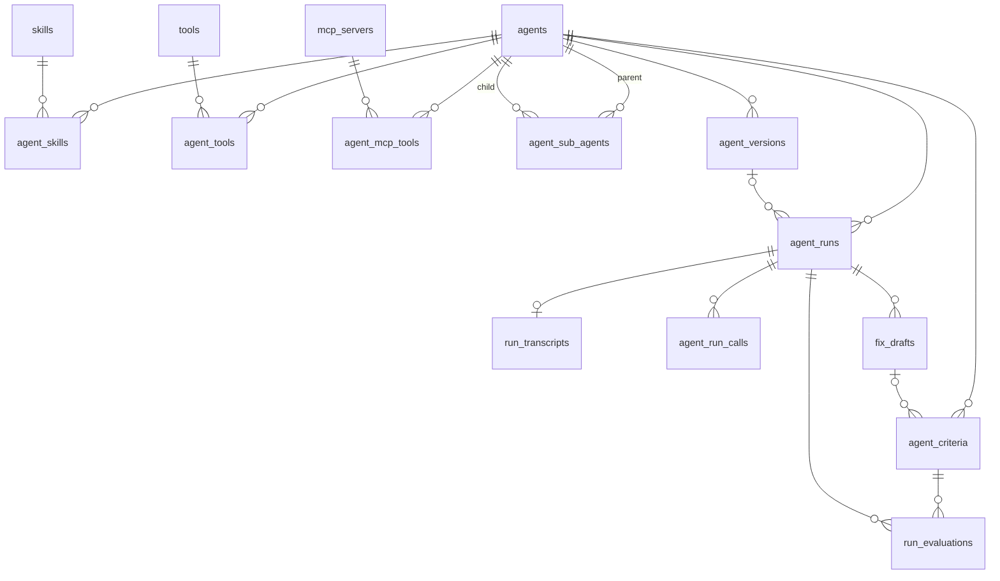

# Architecture

## Packages

Turborepo + pnpm-workspaces monorepo, four packages:

- **`apps/web`** — Next.js 16 App Router. Serves the dashboard UI, the `/api/*` CRUD routes, the public OpenAI-compatible surface under `/v1`, and the MCP endpoint under `/mcp/agents/[id]`.
- **`packages/db`** — Drizzle ORM schema, Postgres client, migrations (`drizzle/*.sql`), seed scripts.
- **`packages/runner`** — Builds an AI SDK 7 `ToolLoopAgent` from a DB-defined agent row. Nothing is precompiled per agent: `buildAgentRuntime` (`packages/runner/src/runtime.ts`) assembles tools, skills, approval strategy and stats collector fresh on every request.

- **`packages/openai-server`** — Translates between the OpenAI Chat Completions wire format and the AI SDK: a generate result into a blocking `chat.completion`, a `fullStream` into an SSE `Response` of `chat.completion.chunk` frames (including index-addressed `tool_calls` deltas), and an incoming OpenAI `messages` array back into `ModelMessage[]`. Depends on nothing in this repo — `ai` is a peer — because no such helper exists in the SDK and the problem is not specific to agentlathe.

`apps/web` depends on both `packages/db` and `packages/runner`. `packages/runner` depends on `packages/db` for the schema, naming helpers, and run-recording functions, and on `packages/openai-server` for the `/v1` serialization it re-exports.

Agents reference models by slug (the `agents.model` column) — an OpenRouter slug by default, or whatever slug the configured OpenAI-compatible endpoint serves. Multi-provider access goes through `@ai-sdk/openai-compatible` (`createOpenAICompatible` → `https://openrouter.ai/api/v1`), not `@openrouter/ai-sdk-provider`.

## Data model

Schema lives in `packages/db/src/schema.ts`. Sixteen tables: six entities, six run-record tables, four join tables.

**Entities**

- `agents` — `id`, `name` (unique), `slug` (unique — the human-chosen ID used by `/v1` and the MCP URL), `description`, `model`, `system_prompt`, `max_steps` (default 20), `is_active`, `record_traffic` (default false), `auto_evaluate` (default true; whether a run is judged as soon as its transcript is stored — see [Automatic evaluation](#automatic-evaluation)), timestamps.
- `skills` — `id`, `name`, `description`, `content`, `is_active`, timestamps.
- `tools` — `id`, `name`, `description`, `endpoint`, `input_schema` (jsonb), `needs_approval`, `is_active`, timestamps.
- `mcp_servers` — `id`, `name`, `server_url`, `auth_config` (jsonb, nullable), `is_active`, timestamps.
- `settings` — singleton row (`id` defaults to `"singleton"`), `track_dashboard_runs` (default true), `track_v1_runs` (default false), `track_mcp_runs` (default false), `agent_run_ttl_days` (default 90, CHECK `>= 0`), `transcript_ttl_days` (default 14, CHECK `>= 0`), `judge_model` (default `'typesafe/jev-1.13'`, the Decisions API model the evaluators ask).
- `agent_criteria` — the yes/no questions an agent's runs are judged against, phrased so that yes is good. `agent_id` FK → `agents.id` ON DELETE CASCADE (indexed), `question`, `pass_description` / `fail_description` (nullable; sent to the judge as what a yes and a no look like), `applies_when` (nullable yes/no condition), `fail_below` (real, default 0.2) and `pass_above` (real, default 0.8) with CHECK `0 <= fail_below <= pass_above <= 1`, `is_active`, `source_fix_draft_id` (nullable) FK → `fix_drafts.id` ON DELETE SET NULL — the review note it was promoted from, which must belong to a run of the same agent — timestamps.

**Run records**

- `agent_versions` — one row per distinct configuration an agent has run with. `agent_id` FK → `agents.id` ON DELETE CASCADE, `hash` (sha256 hex of the canonical snapshot), `snapshot` (jsonb), `created_at`. UNIQUE `(agent_id, hash)` (its index also serves lookups by `agent_id`). Written only by `resolveAgentVersion` (see [Agent versions](#agent-versions)).
- `agent_runs` — one row per call from any transport. `agent_id` FK → `agents.id` ON DELETE CASCADE. `agent_version_id` (nullable) FK → `agent_versions.id` ON DELETE SET NULL. `source` CHECK in `('dashboard','v1','mcp')`. `thread_id` (nullable text, no FK — there is no conversation table). `status` CHECK in `('ok','error')`. `model` (nullable text), `duration_ms`, `steps`, `tool_calls`, `input_tokens`, `output_tokens`, `approvals_requested`, `approvals_granted`, `mcp_failures` (nullable jsonb, list of servers whose tools were missing for the run — failed to connect, or connected without offering a selected tool), `error`. Indexes on `agent_id`, `created_at`, `source`, `thread_id`, `agent_version_id`.
- `agent_run_calls` — one row per tool/mcp/sub-agent/skill invocation within a run. `run_id` FK → `agent_runs.id` ON DELETE CASCADE. `kind` CHECK in `('tool','mcp','sub_agent','skill')`. `status` CHECK in `('ok','error','denied')`. `name`, `duration_ms` (nullable). Indexes on `run_id`, `name`.
- `run_transcripts` — 1:1 with `agent_runs` (`run_id` is both PK and FK, ON DELETE CASCADE). `input` and `output` (jsonb, both required). Own `created_at`, own index — deleted independently of, and on a shorter TTL than, the run row.
- `fix_drafts` — review notes anchored to a run. `run_id` FK → `agent_runs.id` ON DELETE CASCADE. `message_id`, `anchor` (jsonb), `category` CHECK in `('prompt','tool_definition','tool_policy','missing_tool','model','other')`, `rationale`, `proposed_value` (nullable), `status` CHECK in `('open','dismissed','applied')`, default `'open'`. Indexes on `run_id`, `status`.
- `run_evaluations` — one verdict per run and criterion. `run_id` FK → `agent_runs.id` ON DELETE CASCADE, `criterion_id` FK → `agent_criteria.id` ON DELETE CASCADE (indexed). `question_snapshot` (the question as it was judged), `p_pass` / `p_applies` (nullable reals), `status` CHECK in `('pass','fail','needs_review','not_applicable','skipped','error')`, `skip_reason` CHECK in `('too_long','awaiting_approval')`, `error`, `judge_model` (the dated model the judge answered with), `reviewed_verdict` CHECK in `('pass','fail')` (nullable — the human's review), `created_at`. UNIQUE `(run_id, criterion_id)` (its index also serves lookups by `run_id`). Written only by `evaluateRun` (see [Evaluation](#evaluation)).

**Join tables** (composite PK, no surrogate id, `uuid[]` arrays never used)

- `agent_skills` — PK `(agent_id, skill_id)`, both FK ON DELETE CASCADE.
- `agent_tools` — PK `(agent_id, tool_id)`, both FK ON DELETE CASCADE.
- `agent_sub_agents` — PK `(parent_id, child_id)`, both FK → `agents.id` ON DELETE CASCADE. CHECK `parent_id <> child_id` (`agent_sub_agents_parent_child_check`) blocks direct self-reference at the DB level; the runner enforces cycle/depth limits at runtime for indirect cycles (A→B→A), which the CHECK cannot catch.
- `agent_mcp_tools` — PK `(agent_id, server_id, tool_name)`. `server_id` FK → `mcp_servers.id` ON DELETE CASCADE. `tool_name` is explicit text, not a wildcard — MCP tool selection is per named tool, and each selection carries its own `needs_approval` flag (the per-agent approval gate).

Deactivation (`is_active = false`) is the normal CRUD flow; hard delete cascades through the join tables and, for agents, through `agent_runs` (and everything hanging off it).

## Metrics recording

Two independent gates decide what gets persisted for a call:

1. **Run-row gate** — `settings.track_dashboard_runs` / `track_v1_runs` / `track_mcp_runs`, checked per `source` inside `recordAgentRun` (`packages/db/src/runs.ts`). If the gate for that source is off, no `agent_runs` row is inserted and the function returns `null`.
2. **Transcript gate** — `source === "dashboard" || agent.recordTraffic`, checked inside `RunRecorder.attachTranscript` (`packages/runner/src/recording.ts`). The Playground always stores a transcript when a run row exists; `/v1` and MCP only store one if the agent has `record_traffic` on. A missing run row (gate 1 failed) means `attachTranscript` is a no-op regardless of gate 2 — no run row, no transcript, nothing to annotate.

Both gates are evaluated inside `createRunRecorder`, the single writer of the run record; no transport calls `recordAgentRun` or `saveRunTranscript` directly. A transcript that passes both and is stored is what triggers [automatic evaluation](#automatic-evaluation).

**Stats collection has one producer.** `buildAgentRuntime` installs `onToolExecutionEnd` / `onStepEnd` as `ToolLoopAgent` *constructor* callbacks (`packages/runner/src/runtime.ts`), so dashboard, `/v1`, and MCP all record identical fidelity: per-call `durationMs`, `status` (`ok`/`error`/`denied`), plus run-level `steps`, `toolCalls`, token usage, `approvalsRequested`, `approvalsGranted`. Denials surface through three different code paths depending on how the denial happened:

- A same-run auto-denial (headless transports) emits a `tool-approval-response` part with `approved: false`, caught by the collector's `onStepEnd`.
- An MCP denial decided inside the interactive approval loop is recorded by `generateWithApprovals` at decision time (it pushes a `denied` call record directly, since that denial never produces a step part).
- A Playground denial is decided in the *next* HTTP turn: it arrives as an `approval-responded` part with `approved: false` in that turn's input `UIMessage`s, and produces no step part at all. `streamAgentForUI` scans the input for these (`deniedApprovalCalls` in `recording.ts`) and appends them to that turn's stats before recording.

The collector dedupes denials by tool-call id, so already-processed history is never re-counted. Stats-collecting callbacks are only ever passed at the `ToolLoopAgent` constructor level, never at the call (`.generate`/`.stream`) level — both fire if both are set, which would double-count.

`recordAgentRun` and `saveRunTranscript` both wrap their body in try/catch and log-and-swallow on failure (`recordAgentRun` returns `null`, `saveRunTranscript` returns `false`). A recording failure never fails or alters the run's response to the caller.

### Agent versions

Every recorded run points at the configuration it ran with. When the run's source is tracked (the same `isTrackingEnabled` check `recordAgentRun` makes), `createRunRecorder` starts `resolveAgentVersion(agent.id)` (`packages/runner/src/versions.ts`) when it is created — the config the run *started* with, not whatever is saved by the time it ends — and `record` awaits it before calling `recordAgentRun`. An untracked source resolves and stores nothing. A failed resolution is logged and swallowed to `null`, like every other recording failure: the run is still recorded, with `agent_version_id` null.

`resolveAgentVersion` loads configs through the same loaders the runtime uses. Each agent's *local* snapshot (`agentConfigSnapshot`) keeps only what changes that agent's behavior:

- the agent's `model`, `system_prompt` (null and empty are the same, as in the runtime), `max_steps` — not its id, name, slug, description, flags or timestamps;
- active skills: name, description, content;
- active HTTP tools: name, description, endpoint, input schema, `needs_approval`;
- active MCP servers: name (it prefixes the tool names), URL, selected tool names and which of them need approval. **Never `auth_config`**: it can hold literal secrets, and `agent_versions` has no TTL. The remote tool schemas are not part of it either (they are unknown without connecting), so a change on the MCP server's side does not create a new version;
- active sub-agents, only as the parent's delegation tool exposes them: slug (it names the tool) and the description the parent sees (`description`, or the name when there is none).

Endpoints and server URLs go through `maskUrl`: only scheme and host (with port) stay readable, and everything after them — userinfo, path, query, fragment — becomes one `sha256:` digest (12 hex characters) of the whole original URL, so a change anywhere in it still changes the version without the secret being stored (a path can carry one, as in a Slack webhook). A URL with nothing after the host is kept as is; a string that is not an http(s) URL is digested whole.

The version snapshot is the root's local snapshot plus `descendants`: `{ slug, hash }` of the local snapshot of every agent reachable from the root within the runtime's depth limit. The runtime builds sub-agent tools at every level and refuses a delegation from depth `MAX_DEPTH` (5) or into an agent already in the call stack, so the agents that can execute are exactly those at shortest distance ≤ `MAX_DEPTH`. They are found by a breadth-first walk with a visited set, one `Promise.all` of loads per level: each agent is loaded once, cycles end at the visited set, and editing any reachable descendant creates a new version of the root while one beyond the limit does not.

Before hashing (`hashSnapshot`, sha256), object keys are ordered recursively, and only the entity lists (skills, HTTP tools, MCP servers, sub-agents, descendants) and the MCP tool-name lists are sorted. Arrays inside values — an input schema's `enum`, `required`, `prefixItems` — keep their order, which is semantic or visible to the model. The trade-off goes the other way for row order: the runtime's skill listing and `addTool` collision suffixes follow DB row order, which the snapshot normalizes away. The root version is upserted with `ON CONFLICT (agent_id, hash) DO NOTHING` and its id returned; descendant hashes live only inside the root's snapshot.

The snapshot is read back in two places, both through `readSnapshot` (`apps/web/lib/version-diff.ts`, pure), which fills a missing field with an empty value so a snapshot written in an older shape still renders. The run page shows the snapshot of the run's version. The metrics page diffs each version column against the one to its left (`diffVersions`, called from `assembleAgentEvaluation`): agent fields as values, the prompt and every text field as a line diff (`diff`'s `structuredPatch`, 3 lines of context), and skills, HTTP tools, MCP servers and sub-agents matched by name (slug for sub-agents) into added, removed or edited. A descendant is only a hash in the snapshot, so a changed descendant is reported as changed, without detail.

## Evaluation

A run is judged against its agent's criteria by TypeSafe's Jev through a Decisions API (OpenRouter's by default) — not chat completions, and the one place the app talks to something that is not OpenAI-compatible. A run is evaluated automatically once its transcript is stored (see [Automatic evaluation](#automatic-evaluation)), or on demand: `POST /api/runs/[id]/evaluate` (optionally restricted to `criterionIds`, which must belong to the run's agent), `POST /api/agents/[id]/criteria/evaluate-recent` for a batch, and `POST /api/runs/[id]/evaluate/preview` for one unsaved criterion, which runs the same pipeline and writes nothing.

`evaluateRun` (`apps/web/lib/evaluations.ts`) loads the run, its transcript, the agent's active criteria and `settings.judge_model` in one `Promise.all`, then:

1. **No transcript** → returns `{ skipped: "no_transcript" }` and writes nothing.
2. **Transcript → state** (`evaluationInput`, `apps/web/lib/evaluation-input.ts`, pure): `toTranscriptMessages` normalizes input then output — dashboard `UIMessage`s, the raw OpenAI `messages` `/v1` receives (assistant `tool_calls` paired with their `role: "tool"` results; `developer` read as `system`) and the `ModelMessage`s it produces (`tool-result` outputs unwrapped into output/error/denied states), and MCP's plain role/content — and each message becomes plain lines: `USER: …`, `ASSISTANT: …`, and `TOOL CALL name(input) -> result`, where the result is the output, `ERROR: …`, `DENIED by the user` (a denial in the UI, or the headless `execution-denied` output of `/v1`) or `PAUSED: waiting for human approval (run ended here)`. Tool inputs and outputs are capped at 2000 characters. System messages, reasoning and empty text are dropped. The dashboard and `/v1` send the whole thread on every turn, so the state is split at the last user message of the input: from it on (plus the output) goes under `=== THIS RUN (evaluate this) ===`; before it, **only the earlier user lines** go under `=== EARLIER CONVERSATION (context only, already evaluated) ===`, capped to its most recent ~6000 characters (`…[earlier messages omitted]`), and omitted when there are none. Earlier assistant text and tool calls are left out on purpose: measured against the real judge, a refund promised in an earlier turn still dragged a clean current run down, while user-only context kept context-dependent criteria working. The header strings live in `evaluation-input.ts` only. MCP transcripts only hold the user message and the final text, so criteria about tool use cannot be judged on MCP runs.
3. **Paused run** — the final message is an assistant message with any part still in `approval-requested` (parallel calls make their order arbitrary) — → every criterion is `skipped`/`awaiting_approval`, and the judge is not called: the turn did not end.
4. **One judge call** (`askJudge`, `apps/web/lib/judge.ts`) per run, whatever the number of criteria: `{ model, state, questions }` with one `noul` question per criterion (`criteria: { true, false }` from the pass and fail descriptions; when only one exists it is appended to the instructions instead) plus one per criterion with `applies_when`. `judgeEndpoint()` picks the URL and bearer: `JUDGE_URL` with `JUDGE_API_KEY` (required — the provider key never goes to another host), or by default `../alpha/decisions` resolved against `PROVIDER_BASE_URL` with `JUDGE_API_KEY ?? PROVIDER_API_KEY`. The request and response are the same on every host that serves Jev (TypeSafe's `/v1/systemone`, OpenRouter's `/api/alpha/decisions` and `/api/v1/systemone`), and so is the too-long body (`{"detail":{"error_type":"max_tokens_exceeded"}}`, embedded in `error.message` by OpenRouter). The timeout is 20s. A `max_tokens_exceeded` rejection (free) makes every criterion `skipped`/`too_long`; any other failure — a 404 from an endpoint that does not serve the API, a rejected key, an unknown model, a timeout, a probability outside [0, 1] — makes every criterion `error` with the message.
5. **Verdict** (`deriveStatus`, `apps/web/lib/evaluation-verdict.ts`): applicability first, then the verdict, both against the criterion's own thresholds — `p < fail_below` is a no, `p >= pass_above` a yes, anything between is `needs_review`. A no on applicability is `not_applicable`.

Every outcome is upserted on `(run_id, criterion_id)` with the question snapshot and the dated model from the response. A real judgement (`pass`, `fail`, `needs_review`, `not_applicable`) replaces the previous row; `reviewed_verdict` is kept while the new `question_snapshot` equals the stored one (a human review belongs to the question it answered) and cleared only when the question text changed. An `error` or `skipped` outcome is written only where there is no row yet or the row is itself `error`/`skipped`: a failed call never destroys a judged verdict or its human review. The response carries the rows as stored plus `notJudged` (status, skip reason, error) when the run was not judged — a failed call or a skip. A repeated `error`/`skipped` outcome over an `error`/`skipped` row keeps its `reviewed_verdict`: for a run too long to judge, the human review is the only verdict it can have. `PATCH /api/runs/[id]/evaluations/[evaluationId]` sets or clears the human review.

| `status` | Meaning |
|---|---|
| `pass` / `fail` | `p_pass` at or above `pass_above` / below `fail_below` |
| `needs_review` | `p_pass` or `p_applies` between the thresholds |
| `not_applicable` | `p_applies` below `fail_below` |
| `skipped` | `skip_reason` `too_long` (rejected by the judge for length) or `awaiting_approval` (run paused on an approval) |
| `error` | the judge call failed; `error` holds why |

Criteria are managed under `/api/agents/[id]/criteria`; deactivation (`isActive: false`) is the normal flow, and a hard delete cascades the criterion's evaluations.

### Automatic evaluation

The hook hangs off the single writer. `createRunRecorder` takes an optional `onTranscriptSaved(runId)`, which `attachTranscript` calls only when the transcript was actually stored: a run row exists (run-row gate), the transcript gate passed, and `saveRunTranscript` returned `true`. A throwing callback is caught and logged inside the recorder. The runner knows nothing about evaluation: `apps/web/lib/run-recorder.ts` wraps it as `createRecorder`, which wires the callback to `scheduleRunEvaluation`, and the three transports create their recorder through it — none of them calls `evaluateRun`.

`scheduleRunEvaluation(runId, agent)` returns at once. It checks `agent.auto_evaluate` on the in-memory row before any query. On a microtask it then runs `hasActiveCriteria(agent.id)`, a single `LIMIT 1` query: `auto_evaluate` defaults to true, so an agent without criteria must cost that query and never a read of the transcript's jsonb. Only with an active criterion does `evaluateRun(runId)` load the run. That call goes through a module-level limiter (`createLimiter(3)`, `apps/web/lib/limiter.ts`): at most three background evaluations are in flight per server process, the rest wait in order, and a rejected task frees its slot. The whole chain, already running, is handed to `after()` from `next/server`. Any error is logged and swallowed; the transport's response, status and recording never depend on it. A judge failure is stored as `error` rows like any other evaluation.

`after()` gets a promise, not a callback, on purpose (verified in `next@16.2.9`). `after()` throws only when there is no work store (`dist/server/after/after.js`), which is the case when a handler is invoked as a plain function, as the integration suites do; the scheduler then swallows the throw and the evaluation, already running, completes fire-and-forget on the long-lived Node server. Inside a real request the store is there even from stream callbacks — the MCP and `/v1` streaming bodies run in a `ReadableStream` `start()` invoked synchronously inside the handler, so `AsyncLocalStorage` carries it — but a *callback* is queued until the response's `close` event: `AfterContext.addCallback` subscribes through `onClose` once (`dist/server/after/after-context.js`, lines 68–71, 90–92), and route handlers wire `onClose` to `res.on('close', cb)` (`dist/build/templates/app-route.js`, lines 230–232). The `/v1` stream serializer calls `controller.close()` before its `onDone` records the run (`packages/openai-server/src/index.ts`), so the response can already be closed when the transcript is saved, and a callback subscribed then would never run. A promise goes straight to `waitUntil` (`after-context.js`, lines 34–38), which self-hosted Next tracks so a graceful shutdown awaits it (`createInternalWaitUntil`, `dist/server/next-server.js`). Because the integration suites call handlers as functions, they always take the fire-and-forget branch; the real `after(promise)` path is left to the browser E2E, the only level that boots a server.

**Batch re-evaluation** — `POST /api/agents/[id]/criteria/evaluate-recent`, body `{ limit?: number }` (default 50, 1–200), runs regardless of `auto_evaluate`: it is an explicit request. With no active criterion it returns zeros without loading runs. Otherwise it takes the agent's most recent runs that have a transcript, runs `evaluateRun` on them four at a time through its own `createLimiter(4)`, awaits them, and returns `{ runs, pass, fail, needsReview, notApplicable, skipped, error, notJudged, stoppedEarly }`.

- **Judged runs** count their evaluation rows by status.
- **Runs the judge did not judge** count once in `notJudged`. Their criteria count under the outcome of *this* call (`error`, or `skipped` for `too_long` / `awaiting_approval`), never under an earlier verdict the upsert kept: a judge that is down must not read as a passing batch. A transcript gone by then, or an unexpected throw, also counts as `notJudged`.
- **Stopping early.** The batch is bounded because 200 runs against a 20s judge timeout could hold a request for minutes. A run about to start is skipped, counted in `notJudged` with no judge call, once `req.signal` is aborted (`stoppedEarly: "aborted"`) or after three consecutive judge failures — an `error` outcome or a throw, reset by any judged or skipped run (`stoppedEarly: "judge_failing"`). Runs already in flight finish. `stoppedEarly` is `null` when no run was skipped this way.

### Evaluation metrics

The metrics pages read verdicts with the same counting rules as the agent page's Evaluation tab: the effective verdict is `coalesce(reviewed_verdict, status)`, `not_applicable` / `skipped` / `error` stay out of the rate, and only verdicts whose `question_snapshot` equals the criterion's current question count. `lib/queries-metrics.ts` owns only the SQL (per-agent: one aggregate per criterion × agent version × UTC day of the run, scoped by the run's `created_at`; global: one per agent); `assembleAgentEvaluation` and `summarizeEvaluation` in `lib/metrics-assembly.ts` do the reshaping — version ordering by last run in the range, rates, the newest-vs-previous delta (only with at least 5 judged verdicts on both sides), the daily series and the judge-vs-human agreement — and are unit-tested without Postgres.

## Retention

`settings.agentRunTtlDays` (default 90) and `settings.transcriptTtlDays` (default 14) bound how long `agent_runs` and `run_transcripts` rows live. `deleteExpiredAgentRuns` / `deleteExpiredTranscripts` (`packages/db/src/runs.ts`) each delete rows older than `now - ttlDays`; a `ttlDays <= 0` is treated as "no sweep" (early return). `agent_run_calls`, `fix_drafts` and `run_evaluations` go with their run by cascade, so a verdict outlives its transcript (and the run can no longer be re-evaluated). `agent_versions` has no TTL: a version row stays while its agent exists, which is why its snapshot must never hold a secret.

There is no cron. `scheduleRetentionSweep` (`apps/web/lib/retention.ts`) schedules both deletions via `after()` from `next/server`, called explicitly from the pages that display run data. The sweep runs after the response is sent, lazily, driven by page views — it is never invoked implicitly from inside a read/query function.

## Invocation surfaces

Three transports call into the same runner (`buildAgentRuntime` / `generateWithApprovals` / `streamAgentForUI`), each with different approval semantics:

**Playground** — `POST /api/agents/[id]/chat` (`apps/web/app/api/agents/[id]/chat/route.ts`) → `streamAgentForUI`, which composes `createAgentUIStream` + `createUIMessageStream` into a `UIMessageStream` for `useChat`. Uses `buildDashboardToolApproval`: a `needs_approval` tool call pauses the loop and surfaces an approval banner in the UI; the human's decision travels back as an `approval-responded` part in the *next* turn's messages. Always records a transcript: the request messages as input and the turn's assistant message as output. When the turn continues an approval (`isContinuation` in the SDK's `onEnd` event), the client resent the paused assistant message and the SDK extends it in place, so `streamAgentForUI` moves that message out of the input and stores its extended version — executed tool and final answer, same id the client saw — as the output (`onTranscript`). That output therefore also carries the earlier parts of the message it continues, so the work before the pause appears again in the continuation's "THIS RUN". Returns the run id as a `data-run` stream part (it only exists once the turn has ended, with the stream already in flight — it cannot travel in a response header) and the thread id in the `x-thread-id` response header.

**`/v1` (OpenAI-compatible)** — `POST /v1/chat/completions` and `GET /v1/models`. Stateless: the client owns the full `messages` array on every call, no server-side history. Uses `buildHeadlessToolApproval`: a `needs_approval` tool call is auto-denied with an explanatory tool-result — there is no human to approve it. Model lookup goes through `loadActiveAgent` (uuid-safe: looks up by id when the string is a uuid, by slug — preferred — or name otherwise), the only path any transport uses to fetch an agent row. Accepts an optional `x-thread-id` request header to group calls under one `agent_runs.thread_id`.

**MCP** — `POST /mcp/agents/[id]` (`apps/web/app/mcp/agents/[id]/route.ts`), where `[id]` is the agent's slug, its URL-encoded name or its uuid, resolved through the same `loadActiveAgent` as `/v1`. Streamable HTTP, JSON-RPC 2.0. Exposes exactly one tool per agent, named `ask_{slug}` (`agentAskToolName`), taking a `message` string. Approval, when the connected client declared `elicitation` capability at `initialize`, goes through an `elicitation/create` JSON-RPC request sent mid-stream; the client's response (`accept` + `approve: true`) resolves a pending promise. The promise bookkeeping lives in `apps/web/lib/approval-broker.ts` (`createApprovalBroker`): `ask()` registers a `requestId` and a 120s timeout that resolves to `false` if the client never answers; `resolve()` settles it from an incoming JSON-RPC response; `rememberSession`/`canElicit` track, per MCP session id, whether that session declared elicitation support (LRU-capped at 500 sessions). Clients that never declared elicitation get headless (auto-deny) approval instead, via the same `buildHeadlessToolApproval` strategy `/v1` uses.

All three transports use `thread_id` purely as a grouping key on `agent_runs` — there is no conversation table. The Playground generates its own thread id per chat session; `/v1` callers can send `x-thread-id` to opt into grouping; MCP calls are not threaded (each `ask_*` call is its own run).

## Runner internals

`buildTools` (`packages/runner/src/tools.ts`) composes an agent's tool set from three independently-loaded sources, run concurrently via `Promise.all`:

- **HTTP tools** (`loadHttpTools`) — one `tool()` per active row joined through `agent_tools`. `execute` does a `POST` to `tools.endpoint` with the tool input as the JSON body, under a 30s timeout (a dedicated `AbortController` + `setTimeout` rather than `AbortSignal.timeout`, so a timeout stays distinguishable from a cancelled run, combined with the caller's `abortSignal` via `AbortSignal.any`). A non-2xx response and a timeout both throw: the SDK feeds the model the error text (`HTTP {status}: {body}`, or the timeout) and keeps looping, and the call is recorded with `status: "error"` instead of `ok`.
- **MCP tools** (`loadMcpTools`) — one `createMCPClient` per active `mcp_servers` row referenced by the agent, connected concurrently via `Promise.allSettled`: a server that fails to connect or list tools is dropped (its name collected in `failed`) without aborting the others. Only the tool names explicitly selected in `agent_mcp_tools` are exposed, and a selected tool the server no longer offers is reported through that same `failed` list as `{server name} (tools no longer offered: …)`. Exposed tool names are namespaced as `{serverSlug}__{toolName}` (`mcpToolName` in `packages/db/src/naming.ts`) to avoid cross-server collisions. Each opened `MCPClient` is tracked and closed in a single `Promise.allSettled` cleanup step (`makeMcpCleanup`) run once per runtime, regardless of how the call ended.
- **Sub-agent tools** (`buildSubAgentTools`) — one tool per row in `agent_sub_agents`, named `subagent_{slug}` (`subAgentToolName`). `execute` builds a full child runtime (`buildSubAgentRuntime`) and calls `childAgent.generate({ prompt: task })`, returning `.text` — never a `Response`. Recursion is bounded by the runner, not the SDK: `RuntimeCtx` (`packages/runner/src/context.ts`) carries a `callStack: Set<agentId>` (copied, not mutated, per branch) and a `depth` counter; a call is refused with an in-band error string (not thrown) if `callStack.has(childId)` (cycle) or `depth >= MAX_DEPTH` (5).

Tool names merged from all sources go through `addTool` (`packages/runner/src/helpers.ts`), which appends a numeric suffix on collision so two differently-sourced tools can never silently overwrite one another. All name derivation (HTTP tool slugs, MCP `server__tool` prefixes, `subagent_*`, the MCP-surface `ask_*`) is centralized in `packages/db/src/naming.ts` (`slug`, `httpToolName`, `mcpToolName`, `subAgentToolName`, `agentAskToolName`). HTTP tool names, sub-agent names and the MCP-surface `ask_*` name strip to `[a-zA-Z0-9_-]`, since providers reject tool names outside that set and fail the whole call — but `mcpToolName` only slugifies the server-name prefix; the remote tool name after `__` is left exactly as the MCP server reports it. A remote tool whose name falls outside that character set is exposed unslugified, so the provider rejects the whole call the first time the model tries to use it.

**Skills** are loaded on demand rather than injected into every tool call: `buildSystemPrompt` appends a list of available skill names + descriptions to the agent's instructions, and a single `load_skill` tool (`buildLoadSkillTool`) returns a skill's full `content` by name when the model decides it needs it.

`assembleRuntime` (`packages/runner/src/runtime.ts`) is the single place that turns an `AgentRow` into a live `ToolLoopAgent`: it merges HTTP/MCP/sub-agent tools with `load_skill`, builds the stats collector (`createRunStatsCollector`), and constructs `new ToolLoopAgent({ model, instructions, tools, stopWhen: stepCountIs(agent.maxSteps), toolApproval, prepareStep, ...collector.callbacks })`. `prepareStep` (`buildPrepareStep`) checks estimated token count against 80% of the model's context limit each step and, if over, prunes via `pruneMessages({ toolCalls: "before-last-3-messages" })` — removing older tool-call/tool-result pairs rather than summarizing, while keeping each pair intact.

## How the system is verified

The test levels, their commands and what each one costs are in [DEVELOPING.md](DEVELOPING.md#test-levels). What matters architecturally is where each kind of test lives and what it is allowed to touch:

| Pattern | Location | Config | Touches |
|---|---|---|---|
| `*.test.ts` | colocated with source | `vitest.config.ts` | nothing external |
| `*.sdk.test.ts` | `packages/runner/src/` | same as unit | the real SDK, no network |
| `*.integration.test.ts` | `tests/integration/` per package | `vitest.integration.config.ts` | Postgres via Testcontainers |
| `*.e2e.test.ts` / `*.e2e.spec.ts` | `tests/e2e/` per package | `vitest.e2e.config.ts` / `playwright.config.ts` | Postgres + a real model |

Two of those rows carry design decisions rather than conventions:

**`*.sdk.test.ts` exists because the SDK contract cannot be assumed.** These run the real `ToolLoopAgent` against a scripted `MockLanguageModelV4` from `ai/test` instead of mocking the SDK, pinning exactly how denials and approvals surface as step parts. They are part of the ordinary unit suite — same command, same config — so the contract is checked on every run.

**Integration suites fail loudly when Docker is missing; they do not skip.** A silent skip once hid that the whole suite was broken. In `apps/web` they invoke Next route handlers directly as functions (`POST(new Request(...), { params: Promise.resolve({ id }) })`) rather than booting a server; the browser E2E is the only level that boots one, on port 3100 against a Testcontainers Postgres.
