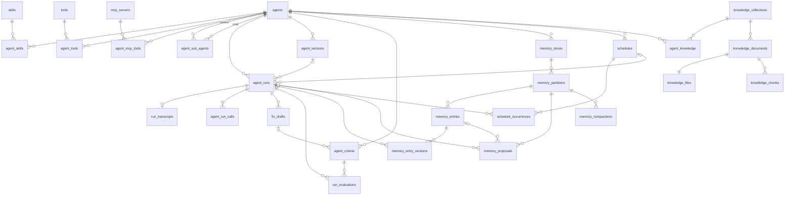

# Architecture

## Packages

Turborepo + pnpm-workspaces monorepo, four packages:

- **`apps/web`** — Next.js 16 App Router. Serves the dashboard UI, the `/api/*` CRUD routes, the public OpenAI-compatible surface under `/v1`, and the MCP endpoint under `/mcp/agents/[id]`, and runs the [scheduler](#scheduler) loop that `instrumentation.ts` starts with the server, and the [knowledge](#knowledge) processing that indexes uploaded documents.
- **`packages/db`** — Drizzle ORM schema, Postgres client, migrations (`drizzle/*.sql`), seed scripts.
- **`packages/runner`** — Builds an AI SDK 7 `ToolLoopAgent` from a DB-defined agent row. Nothing is precompiled per agent: `buildAgentRuntime` (`packages/runner/src/runtime.ts`) assembles tools, skills, memory, knowledge, approval strategy and stats collector fresh on every request.

- **`packages/openai-server`** — Translates between the OpenAI Chat Completions wire format and the AI SDK: a generate result into a blocking `chat.completion`, a `fullStream` into an SSE `Response` of `chat.completion.chunk` frames (including index-addressed `tool_calls` deltas), and an incoming OpenAI `messages` array back into `ModelMessage[]`. Depends on nothing in this repo — `ai` is a peer — because no such helper exists in the SDK and the problem is not specific to agentlathe.

`apps/web` depends on both `packages/db` and `packages/runner`. `packages/runner` depends on `packages/db` for the schema, naming helpers, and run-recording functions, and on `packages/openai-server` for the `/v1` serialization it re-exports.

Agents reference models by slug (the `agents.model` column) — an OpenRouter slug by default, or whatever slug the configured OpenAI-compatible endpoint serves. Multi-provider access goes through `@ai-sdk/openai-compatible` (`createOpenAICompatible` → `https://openrouter.ai/api/v1`), not `@openrouter/ai-sdk-provider`.

## Data model

Schema lives in `packages/db/src/schema.ts`. Twenty-nine tables: nine entities, seven run-record tables, five memory tables, three knowledge tables, five join tables.

**Entities**

- `agents` — `id`, `name` (unique), `slug` (unique — the human-chosen ID used by `/v1` and the MCP URL), `description`, `model`, `system_prompt`, `max_steps` (default 20), `is_active`, `record_traffic` (default false), `auto_evaluate` (default true; whether a run is judged as soon as its transcript is stored — see [Automatic evaluation](#automatic-evaluation)), timestamps.
- `skills` — `id`, `name`, `description`, `content`, `is_active`, timestamps.
- `tools` — `id`, `name`, `description`, `endpoint`, `input_schema` (jsonb), `needs_approval`, `is_active`, timestamps.
- `mcp_servers` — `id`, `name`, `server_url`, `auth_config` (jsonb, nullable), `is_active`, timestamps.
- `settings` — singleton row (`id` defaults to `"singleton"`), `track_dashboard_runs` (default true), `track_v1_runs` (default false), `track_mcp_runs` (default false), `track_schedule_runs` (default true), `scheduler_heartbeat_at` (nullable; the last tick of a running scheduler loop), `agent_run_ttl_days` (default 90, CHECK `>= 0`), `transcript_ttl_days` (default 14, CHECK `>= 0`), `judge_model` (default `'typesafe/jev-1.13'`, the Decisions API model the evaluators ask).
- `schedules` — an agent run on a preset trigger. `agent_id` FK → `agents.id` ON DELETE CASCADE (indexed), `name`, `frequency` CHECK in `('hourly','daily','weekdays','weekly','monthly')`, `time_of_day` (`HH:MM`, 24 h, CHECK on the format), `weekday` (0–6, present exactly when weekly), `start_date` (date, required when monthly — its day is the day of the month), `timezone` (IANA), `input` (the message the run receives), `is_active`, `next_run_at` (nullable; partial index where `is_active`), `consecutive_failures` (default 0, CHECK `>= 0`), `paused_reason` (nullable), `subject_id` and `memory_key` (nullable; what its runs act for, as if sent in `x-subject-id` / `x-memory-key`), timestamps.
- `agent_criteria` — the yes/no questions an agent's runs are judged against, phrased so that yes is good. `agent_id` FK → `agents.id` ON DELETE CASCADE (indexed), `question`, `pass_description` / `fail_description` (nullable; sent to the judge as what a yes and a no look like), `applies_when` (nullable yes/no condition), `fail_below` (real, default 0.2) and `pass_above` (real, default 0.8) with CHECK `0 <= fail_below <= pass_above <= 1`, `is_active`, `source_fix_draft_id` (nullable) FK → `fix_drafts.id` ON DELETE SET NULL — the review note it was promoted from, which must belong to a run of the same agent — timestamps.
- `memory_stores` — an agent's memory, at most one active. `owner_agent_id` FK → `agents.id` ON DELETE CASCADE, `scope` CHECK in `('agent','agent_subject','custom')`, UNIQUE `(owner_agent_id, scope)` — switching scope deactivates the others and keeps their content — `memory_key` (present exactly when `custom`: the `x-memory-key` value the agent expects), `name`, `purpose`, `char_limit` (default 8000, CHECK between 1 and 20000), `require_approval` (default false), `is_active`, timestamps.
- `knowledge_collections` — a set of documents agents can be given. `name` (unique), `description` (default `''`; the agent reads it in its instructions to decide when to search), timestamps. No `is_active`: a collection is attached or not.

**Run records**

- `agent_versions` — one row per distinct configuration an agent has run with. `agent_id` FK → `agents.id` ON DELETE CASCADE, `hash` (sha256 hex of the canonical snapshot), `snapshot` (jsonb), `created_at`. UNIQUE `(agent_id, hash)` (its index also serves lookups by `agent_id`). Written only by `resolveAgentVersion` (see [Agent versions](#agent-versions)).
- `agent_runs` — one row per call from any transport. `agent_id` FK → `agents.id` ON DELETE CASCADE. `agent_version_id` (nullable) FK → `agent_versions.id` ON DELETE SET NULL. `schedule_id` (nullable) FK → `schedules.id` ON DELETE SET NULL. `source` CHECK in `('dashboard','v1','mcp','schedule')`. `thread_id` (nullable text, no FK — there is no conversation table). `subject_id` (nullable text; who the run acted for). `status` CHECK in `('ok','error')`. `model` (nullable text), `duration_ms`, `steps`, `tool_calls`, `input_tokens`, `output_tokens`, `approvals_requested`, `approvals_granted`, `mcp_failures` (nullable jsonb, list of servers whose tools were missing for the run — failed to connect, or connected without offering a selected tool), `warnings` (nullable jsonb, `{ code, message }[]`; memory's, such as a run that lacked the subject its memory needs, and knowledge's `knowledge_too_large`), `memory_seen` (nullable jsonb, `{ storeId, partitionKey, revision }[]`: the memory revision the run loaded), `error`. Indexes on `agent_id`, `created_at`, `source`, `thread_id`, `subject_id`, `agent_version_id`, `schedule_id`.
- `schedule_occurrences` — one row per time a schedule came due, whether or not it ran. `schedule_id` FK → `schedules.id` ON DELETE CASCADE, `nominal_at` (the time it was due), `status` CHECK in `('running','succeeded','failed','skipped_overlap','skipped_missed','blocked_preflight','interrupted')`, `reason` (nullable), `run_id` (nullable) FK → `agent_runs.id` ON DELETE SET NULL (indexed), `started_at`, `heartbeat_at`, `finished_at`. UNIQUE `(schedule_id, nominal_at)`: one occurrence per due time, however many processes see it.
- `agent_run_calls` — one row per tool/mcp/sub-agent/skill/memory/knowledge invocation within a run. `run_id` FK → `agent_runs.id` ON DELETE CASCADE. `kind` CHECK in `('tool','mcp','sub_agent','skill','memory','knowledge')`. `status` CHECK in `('ok','error','denied')`. `name`, `duration_ms` (nullable). Indexes on `run_id`, `name`.
- `run_transcripts` — 1:1 with `agent_runs` (`run_id` is both PK and FK, ON DELETE CASCADE). `input` and `output` (jsonb, both required). Own `created_at`, own index — deleted independently of, and on a shorter TTL than, the run row.
- `fix_drafts` — review notes anchored to a run. `run_id` FK → `agent_runs.id` ON DELETE CASCADE. `message_id`, `anchor` (jsonb), `category` CHECK in `('prompt','tool_definition','tool_policy','missing_tool','model','other')`, `rationale`, `proposed_value` (nullable), `status` CHECK in `('open','dismissed','applied')`, default `'open'`. Indexes on `run_id`, `status`.
- `run_evaluations` — one verdict per run and criterion. `run_id` FK → `agent_runs.id` ON DELETE CASCADE, `criterion_id` FK → `agent_criteria.id` ON DELETE CASCADE (indexed). `question_snapshot` (the question as it was judged), `p_pass` / `p_applies` (nullable reals), `status` CHECK in `('pass','fail','needs_review','not_applicable','skipped','error')`, `skip_reason` CHECK in `('too_long','awaiting_approval')`, `error`, `judge_model` (the dated model the judge answered with), `reviewed_verdict` CHECK in `('pass','fail')` (nullable — the human's review), `created_at`. UNIQUE `(run_id, criterion_id)` (its index also serves lookups by `run_id`). Written only by `evaluateRun` (see [Evaluation](#evaluation)).

**Memory** (all cascade from `memory_stores`; see [Memory](#memory))

- `memory_partitions` — one memory of a store: PK `(store_id, partition_key)`, where the key is the agent id, the subject id or the custom key. `revision` (bumped by every change to an entry's text), `chars` (live content), `next_entry_number` (for short ids), `compacted_at`, timestamps.
- `memory_entries` — identity of an entry, without its text. FK `(store_id, partition_key)` → the partition ON DELETE CASCADE, `short_id` (`a7`, `s3`, `c2` by scope; UNIQUE per partition), `pinned`, `deleted_at`, timestamps.
- `memory_entry_versions` — append-only text of every entry. `entry_id` FK ON DELETE CASCADE, `revision` (indexed with `entry_id`), `op` CHECK in `('add','update','delete','compaction','restore')`, `content` (null for a deletion), `run_id` (nullable, indexed) FK → `agent_runs.id` ON DELETE SET NULL, `author` CHECK in `('agent','human','compaction')`, `created_at`. An entry's text at revision N is its last version at or below N.
- `memory_proposals` — changes waiting for approval. FK to the partition, `op` CHECK in `('add','update','delete')`, `entry_id` (nullable for an add) FK → `memory_entries.id` ON DELETE CASCADE, `content` (null for a delete), `base_revision` (what the run saw), `run_id` (indexed) ON DELETE SET NULL, `status` CHECK in `('pending','approved','rejected')`, `reason`, `created_at`, `decided_at`.
- `memory_compactions` — one per attempt. FK to the partition, `from_revision` / `to_revision`, `model`, `input_tokens` / `output_tokens`, `operations` (jsonb: the plan, and the characters before and after), `status` CHECK in `('running','applied','failed')`, `error`, `created_at`, `finished_at`.

**Knowledge** (all cascade from `knowledge_collections`; see [Knowledge](#knowledge))

- `knowledge_documents` — one uploaded file. `collection_id` FK ON DELETE CASCADE (indexed), `filename`, `media_type` CHECK in `('application/pdf','text/markdown','text/plain')`, `size` (bytes), `text` (nullable; the extracted text, PDF pages joined by a form feed), `pages` (PDF only), `chars`, `status` CHECK in `('pending','processing','ready','failed')` (default `'pending'`), `error`, `attempts` (default 0), `claimed_at` / `claim_id` (the processing claim and its fencing token), `embedding_model` (the model its passages were embedded with), timestamps. Partial index on `created_at` where `status in ('pending','processing')`.
- `knowledge_files` — the original bytes, in a table of their own so that listing documents never reads them. `document_id` PK and FK ON DELETE CASCADE, `bytes` (bytea).
- `knowledge_chunks` — the passages search compares. `document_id` FK ON DELETE CASCADE, `position` (UNIQUE with `document_id`), `page` (nullable; the page the passage starts on), `content`, `embedding` (`real[]`), `embedding_model`. No vector column and no vector index: nothing in the schema needs pgvector.

**Join tables** (composite PK, no surrogate id, `uuid[]` arrays never used)

- `agent_skills` — PK `(agent_id, skill_id)`, both FK ON DELETE CASCADE.
- `agent_tools` — PK `(agent_id, tool_id)`, both FK ON DELETE CASCADE.
- `agent_sub_agents` — PK `(parent_id, child_id)`, both FK → `agents.id` ON DELETE CASCADE. CHECK `parent_id <> child_id` (`agent_sub_agents_parent_child_check`) blocks direct self-reference at the DB level; the runner enforces cycle/depth limits at runtime for indirect cycles (A→B→A), which the CHECK cannot catch.
- `agent_mcp_tools` — PK `(agent_id, server_id, tool_name)`. `server_id` FK → `mcp_servers.id` ON DELETE CASCADE. `tool_name` is explicit text, not a wildcard — MCP tool selection is per named tool, and each selection carries its own `needs_approval` flag (the per-agent approval gate).
- `agent_knowledge` — PK `(agent_id, collection_id)`, both FK ON DELETE CASCADE (`collection_id` indexed). `mode` CHECK in `('search','always')`, default `'search'`.

Deactivation (`is_active = false`) is the normal CRUD flow; hard delete cascades through the join tables and, for agents, through `agent_runs` (and everything hanging off it).

## Metrics recording

Two independent gates decide what gets persisted for a call:

1. **Run-row gate** — `settings.track_dashboard_runs` / `track_v1_runs` / `track_mcp_runs` / `track_schedule_runs`, checked per `source` inside `recordAgentRun` (`packages/db/src/runs.ts`). If the gate for that source is off, no `agent_runs` row is inserted and the function returns `null`.
2. **Transcript gate** — `source === "dashboard" || source === "schedule" || agent.recordTraffic`, checked inside `RunRecorder.attachTranscript` (`packages/runner/src/recording.ts`). The Playground and schedules (the instance's own automation) always store a transcript when a run row exists; `/v1` and MCP only store one if the agent has `record_traffic` on. A missing run row (gate 1 failed) means `attachTranscript` is a no-op regardless of gate 2 — no run row, no transcript, nothing to annotate.

Both gates are evaluated inside `createRunRecorder`, the single writer of the run record; no transport calls `recordAgentRun` or `saveRunTranscript` directly. A transcript that passes both and is stored is what triggers [automatic evaluation](#automatic-evaluation).

**Stats collection has one producer.** `buildAgentRuntime` installs `onToolExecutionEnd` / `onStepEnd` as `ToolLoopAgent` *constructor* callbacks (`packages/runner/src/runtime.ts`), so dashboard, `/v1`, MCP and scheduled runs all record identical fidelity: per-call `durationMs`, `status` (`ok`/`error`/`denied`), plus run-level `steps`, `toolCalls`, token usage, `approvalsRequested`, `approvalsGranted`. Denials surface through three different code paths depending on how the denial happened:

- A same-run auto-denial (headless transports) emits a `tool-approval-response` part with `approved: false`, caught by the collector's `onStepEnd`.
- An MCP denial decided inside the interactive approval loop is recorded by `generateWithApprovals` at decision time (it pushes a `denied` call record directly, since that denial never produces a step part).
- A Playground denial is decided in the *next* HTTP turn: it arrives as an `approval-responded` part with `approved: false` in that turn's input `UIMessage`s, and produces no step part at all. `streamAgentForUI` scans the input for these (`deniedApprovalCalls` in `recording.ts`) and appends them to that turn's stats before recording.

The collector dedupes denials by tool-call id, so already-processed history is never re-counted. Stats-collecting callbacks are only ever passed at the `ToolLoopAgent` constructor level, never at the call (`.generate`/`.stream`) level — both fire if both are set, which would double-count.

`recordAgentRun` and `saveRunTranscript` both wrap their body in try/catch and log-and-swallow on failure (`recordAgentRun` returns `null`, `saveRunTranscript` returns `false`). A recording failure never fails or alters the run's response to the caller.

### Agent versions

Every recorded run points at the configuration it ran with. When the run's source is tracked (the same `isTrackingEnabled` check `recordAgentRun` makes), `createRunRecorder` starts `resolveAgentVersion(agent.id)` (`packages/runner/src/versions.ts`) when it is created — the config the run *started* with, not whatever is saved by the time it ends — and `record` awaits it before calling `recordAgentRun`. An untracked source resolves and stores nothing. A failed resolution is logged and swallowed to `null`, like every other recording failure: the run is still recorded, with `agent_version_id` null.

`resolveAgentVersion` loads configs through the same loaders the runtime uses. Each agent's *local* snapshot (`agentConfigSnapshot`) keeps only what changes that agent's behavior:

- the agent's `model`, `system_prompt` (null and empty are the same, as in the runtime), `max_steps` — not its id, name, slug, description, flags or timestamps;
- active skills: name, description, content;
- active HTTP tools: name, description, endpoint, input schema, `needs_approval`;
- active MCP servers: name (it prefixes the tool names), URL, selected tool names and which of them need approval. **Never `auth_config`**: it can hold literal secrets, and `agent_versions` has no TTL. The remote tool schemas are not part of it either (they are unknown without connecting), so a change on the MCP server's side does not create a new version;
- active sub-agents, only as the parent's delegation tool exposes them: slug (it names the tool) and the description the parent sees (`description`, or the name when there is none);
- its active memory, when it has one: name, scope, purpose, limit, `require_approval` and the custom key. Not its entries, which change on every run; and the field is left out when there is no memory, so an agent without one keeps the hash it had;
- its knowledge collections: name, description and mode. Not their documents, so uploading or deleting a document does not create a new version; left out, like memory, when there are none.

Endpoints and server URLs go through `maskUrl`: only scheme and host (with port) stay readable, and everything after them — userinfo, path, query, fragment — becomes one `sha256:` digest (12 hex characters) of the whole original URL, so a change anywhere in it still changes the version without the secret being stored (a path can carry one, as in a Slack webhook). A URL with nothing after the host is kept as is; a string that is not an http(s) URL is digested whole.

The version snapshot is the root's local snapshot plus `descendants`: `{ slug, hash }` of the local snapshot of every agent reachable from the root within the runtime's depth limit. The runtime builds sub-agent tools at every level and refuses a delegation from depth `MAX_DEPTH` (5) or into an agent already in the call stack, so the agents that can execute are exactly those at shortest distance ≤ `MAX_DEPTH`. They are found by a breadth-first walk with a visited set, one `Promise.all` of loads per level: each agent is loaded once, cycles end at the visited set, and editing any reachable descendant creates a new version of the root while one beyond the limit does not.

Before hashing (`hashSnapshot`, sha256), object keys are ordered recursively, and only the entity lists (skills, HTTP tools, MCP servers, sub-agents, memory stores, knowledge collections, descendants) and the MCP tool-name lists are sorted. Arrays inside values — an input schema's `enum`, `required`, `prefixItems` — keep their order, which is semantic or visible to the model. The trade-off goes the other way for row order: the runtime's skill listing and `addTool` collision suffixes follow DB row order, which the snapshot normalizes away. The root version is upserted with `ON CONFLICT (agent_id, hash) DO NOTHING` and its id returned; descendant hashes live only inside the root's snapshot.

The snapshot is read back in two places, both through `readSnapshot` (`apps/web/lib/version-diff.ts`, pure), which fills a missing field with an empty value so a snapshot written in an older shape still renders. The run page shows the snapshot of the run's version. The metrics page diffs each version column against the one to its left (`diffVersions`, called from `assembleAgentEvaluation`): agent fields as values, the prompt and every text field as a line diff (`diff`'s `structuredPatch`, 3 lines of context), and skills, HTTP tools, MCP servers, sub-agents, the memory and knowledge collections matched by name (slug for sub-agents) into added, removed or edited. A descendant is only a hash in the snapshot, so a changed descendant is reported as changed, without detail.

## Evaluation

A run is judged against its agent's criteria by TypeSafe's Jev through a Decisions API (OpenRouter's by default) — not chat completions, and the one place the app talks to something that is not OpenAI-compatible. A run is evaluated automatically once its transcript is stored (see [Automatic evaluation](#automatic-evaluation)), or on demand: `POST /api/runs/[id]/evaluate` (optionally restricted to `criterionIds`, which must belong to the run's agent), `POST /api/agents/[id]/criteria/evaluate-recent` for a batch, and `POST /api/runs/[id]/evaluate/preview` for one unsaved criterion, which runs the same pipeline and writes nothing.

`evaluateRun` (`apps/web/lib/evaluations.ts`) loads the run, its transcript, the agent's active criteria and `settings.judge_model` in one `Promise.all`, then:

1. **No transcript** → returns `{ skipped: "no_transcript" }` and writes nothing.
2. **Transcript → state** (`evaluationInput`, `apps/web/lib/evaluation-input.ts`, pure): `toTranscriptMessages` normalizes input then output — dashboard `UIMessage`s, the raw OpenAI `messages` `/v1` receives (assistant `tool_calls` paired with their `role: "tool"` results; `developer` read as `system`) and the `ModelMessage`s it produces (`tool-result` outputs unwrapped into output/error/denied states), and MCP's plain role/content — and each message becomes plain lines: `USER: …`, `ASSISTANT: …`, and `TOOL CALL name(input) -> result`, where the result is the output, `ERROR: …`, `DENIED by the user` (a denial in the UI, or the headless `execution-denied` output of `/v1`) or `PAUSED: waiting for human approval (run ended here)`. Tool inputs and outputs are capped at 2000 characters. System messages, reasoning and empty text are dropped. The dashboard and `/v1` send the whole thread on every turn, so the state is split at the last user message of the input: from it on (plus the output) goes under `=== THIS RUN (evaluate this) ===`; before it, **only the earlier user lines** go under `=== EARLIER CONVERSATION (context only, already evaluated) ===`, capped to its most recent ~6000 characters (`…[earlier messages omitted]`), and omitted when there are none. Earlier assistant text and tool calls are left out on purpose: measured against the real judge, a refund promised in an earlier turn still dragged a clean current run down, while user-only context kept context-dependent criteria working. The header strings live in `evaluation-input.ts` only. MCP transcripts only hold the user message and the final text, so criteria about tool use cannot be judged on MCP runs.
3. **Paused run** — the final message is an assistant message with any part still in `approval-requested` (parallel calls make their order arbitrary) — → every criterion is `skipped`/`awaiting_approval`, and the judge is not called: the turn did not end.
4. **One judge call** (`askJudge`, `apps/web/lib/judge.ts`) per run, whatever the number of criteria: `{ model, state, questions }` with one `noul` question per criterion (`criteria: { true, false }` from the pass and fail descriptions; when only one exists it is appended to the instructions instead) plus one per criterion with `applies_when`. `judgeEndpoint()` picks the URL and bearer: `JUDGE_URL` with `JUDGE_API_KEY` (required — the provider key never goes to another host), or by default `../alpha/decisions` resolved against `PROVIDER_BASE_URL` with `JUDGE_API_KEY ?? PROVIDER_API_KEY`. The request and response are the same on every host that serves Jev (TypeSafe's `/v1/systemone`, OpenRouter's `/api/alpha/decisions` and `/api/v1/systemone`), and so is the too-long body (`{"detail":{"error_type":"max_tokens_exceeded"}}`, embedded in `error.message` by OpenRouter). The timeout is 20s. A `max_tokens_exceeded` rejection (free) makes every criterion `skipped`/`too_long`; any other failure — a 404 from an endpoint that does not serve the API, a rejected key, an unknown model, a timeout, a probability outside [0, 1] — makes every criterion `error` with the message.
5. **Verdict** (`deriveStatus`, `apps/web/lib/evaluation-verdict.ts`): applicability first, then the verdict, both against the criterion's own thresholds — `p < fail_below` is a no, `p >= pass_above` a yes, anything between is `needs_review`. A no on applicability is `not_applicable`.

Every outcome is upserted on `(run_id, criterion_id)` with the question snapshot and the dated model from the response. A real judgement (`pass`, `fail`, `needs_review`, `not_applicable`) replaces the previous row; `reviewed_verdict` is kept while the new `question_snapshot` equals the stored one (a human review belongs to the question it answered) and cleared only when the question text changed. An `error` or `skipped` outcome is written only where there is no row yet or the row is itself `error`/`skipped`: a failed call never destroys a judged verdict or its human review. The response carries the rows as stored plus `notJudged` (status, skip reason, error) when the run was not judged — a failed call or a skip. A repeated `error`/`skipped` outcome over an `error`/`skipped` row keeps its `reviewed_verdict`: for a run too long to judge, the human review is the only verdict it can have. `PATCH /api/runs/[id]/evaluations/[evaluationId]` sets or clears the human review.

| `status` | Meaning |
|---|---|
| `pass` / `fail` | `p_pass` at or above `pass_above` / below `fail_below` |
| `needs_review` | `p_pass` or `p_applies` between the thresholds |
| `not_applicable` | `p_applies` below `fail_below` |
| `skipped` | `skip_reason` `too_long` (rejected by the judge for length) or `awaiting_approval` (run paused on an approval) |
| `error` | the judge call failed; `error` holds why |

Criteria are managed under `/api/agents/[id]/criteria`; deactivation (`isActive: false`) is the normal flow, and a hard delete cascades the criterion's evaluations.

### Automatic evaluation

The hook hangs off the single writer. `createRunRecorder` takes an optional `onTranscriptSaved(runId)`, which `attachTranscript` calls only when the transcript was actually stored: a run row exists (run-row gate), the transcript gate passed, and `saveRunTranscript` returned `true`. A throwing callback is caught and logged inside the recorder. The runner knows nothing about evaluation: `apps/web/lib/run-recorder.ts` wraps it as `createRecorder`, which wires the callback to `scheduleRunEvaluation`, and the three transports and the scheduler create their recorder through it — none of them calls `evaluateRun`.

`scheduleRunEvaluation(runId, agent)` returns at once. It checks `agent.auto_evaluate` on the in-memory row before any query. On a microtask it then runs `hasActiveCriteria(agent.id)`, a single `LIMIT 1` query: `auto_evaluate` defaults to true, so an agent without criteria must cost that query and never a read of the transcript's jsonb. Only with an active criterion does `evaluateRun(runId)` load the run. That call goes through a module-level limiter (`createLimiter(3)`, `apps/web/lib/limiter.ts`): at most three background evaluations are in flight per server process, the rest wait in order, and a rejected task frees its slot. The whole chain, already running, is handed to `after()` from `next/server`. Any error is logged and swallowed; the transport's response, status and recording never depend on it. A judge failure is stored as `error` rows like any other evaluation.

`after()` gets a promise, not a callback, on purpose. `after()` throws only when there is no work store (`dist/server/after/after.js`), which is the case when a handler is invoked as a plain function, as the integration suites do; `scheduleRunEvaluation` then swallows the throw and the evaluation, already running, completes fire-and-forget on the long-lived Node server. Inside a real request the store is there even from stream callbacks — the MCP and `/v1` streaming bodies run in a `ReadableStream` `start()` invoked synchronously inside the handler, so `AsyncLocalStorage` carries it — but a *callback* is queued until the response's `close` event: `AfterContext` (`dist/server/after/after-context.js`) runs its callback queue from `onClose`, which route handlers wire to `res.on('close', cb)` (`dist/build/templates/app-route.js`). The `/v1` stream serializer calls `controller.close()` before its `onDone` records the run (`packages/openai-server/src/index.ts`), so the response can already be closed when the transcript is saved: in `next@16.2.9` a callback subscribed then never ran, and 16.4.6 runs it on a later tick. A promise does not depend on when the response closes: it goes straight to `waitUntil`, which self-hosted Next tracks so a graceful shutdown awaits it (`createInternalWaitUntil`, `dist/server/next-server.js`). Because the integration suites call handlers as functions, they always take the fire-and-forget branch; the real `after(promise)` path is left to the browser E2E, the only level that boots a server.

**Batch re-evaluation** — `POST /api/agents/[id]/criteria/evaluate-recent`, body `{ limit?: number }` (default 50, 1–200), runs regardless of `auto_evaluate`: it is an explicit request. With no active criterion it returns zeros without loading runs. Otherwise it takes the agent's most recent runs that have a transcript, runs `evaluateRun` on them four at a time through its own `createLimiter(4)`, awaits them, and returns `{ runs, pass, fail, needsReview, notApplicable, skipped, error, notJudged, stoppedEarly }`.

- **Judged runs** count their evaluation rows by status.
- **Runs the judge did not judge** count once in `notJudged`. Their criteria count under the outcome of *this* call (`error`, or `skipped` for `too_long` / `awaiting_approval`), never under an earlier verdict the upsert kept: a judge that is down must not read as a passing batch. A transcript gone by then, or an unexpected throw, also counts as `notJudged`.
- **Stopping early.** The batch is bounded because 200 runs against a 20s judge timeout could hold a request for minutes. A run about to start is skipped, counted in `notJudged` with no judge call, once `req.signal` is aborted (`stoppedEarly: "aborted"`) or after three consecutive judge failures — an `error` outcome or a throw, reset by any judged or skipped run (`stoppedEarly: "judge_failing"`). Runs already in flight finish. `stoppedEarly` is `null` when no run was skipped this way.

### Evaluation metrics

The metrics pages read verdicts with the same counting rules as the agent page's Evaluation tab: the effective verdict is `coalesce(reviewed_verdict, status)`, `not_applicable` / `skipped` / `error` stay out of the rate, and only verdicts whose `question_snapshot` equals the criterion's current question count. `lib/queries-metrics.ts` owns only the SQL (per-agent: one aggregate per criterion × agent version × UTC day of the run, scoped by the run's `created_at`; global: one per agent); `assembleAgentEvaluation` and `summarizeEvaluation` in `lib/metrics-assembly.ts` do the reshaping — version ordering by last run in the range, rates, the newest-vs-previous delta (only with at least 5 judged verdicts on both sides), the daily series and the judge-vs-human agreement — and are unit-tested without Postgres.

## Retention

`settings.agentRunTtlDays` (default 90) and `settings.transcriptTtlDays` (default 14) bound how long `agent_runs` and `run_transcripts` rows live. `deleteExpiredAgentRuns` / `deleteExpiredTranscripts` (`packages/db/src/runs.ts`) each delete rows older than `now - ttlDays`; a `ttlDays <= 0` is treated as "no sweep" (early return). `agent_run_calls`, `fix_drafts` and `run_evaluations` go with their run by cascade, so a verdict outlives its transcript (and the run can no longer be re-evaluated). `agent_versions` has no TTL: a version row stays while its agent exists, which is why its snapshot must never hold a secret. Neither has memory: entries and their versions stay until someone deletes them, their memory or its agent, or forgets their subject. Nor knowledge: a document, its file and its passages stay until someone deletes it or its collection.

`runRetentionSweep` (`apps/web/lib/retention.ts`) runs both deletions and logs, rather than throws, a failure of either. It has two explicit callers, and is never invoked implicitly from inside a read/query function: the pages that display run data, through `scheduleRetentionSweep`, which hands it to `after()` so it runs once the response is sent; and the [scheduler](#scheduler) loop, on its first tick and every 20th after that (about every ten minutes), which has no request scope and so calls it directly. An instance that only serves `/v1` or MCP is therefore swept as long as its scheduler runs.

## Invocation surfaces

Three transports call into the same runner (`buildAgentRuntime` / `generateWithApprovals` / `streamAgentForUI`), each with different approval semantics:

**Playground** — `POST /api/agents/[id]/chat` (`apps/web/app/api/agents/[id]/chat/route.ts`) → `streamAgentForUI`, which composes `createAgentUIStream` + `createUIMessageStream` into a `UIMessageStream` for `useChat`. Uses `buildDashboardToolApproval`: a `needs_approval` tool call pauses the loop and surfaces an approval banner in the UI; the human's decision travels back as an `approval-responded` part in the *next* turn's messages. Always records a transcript: the request messages as input and the turn's assistant message as output. When the turn continues an approval (`isContinuation` in the SDK's `onEnd` event), the client resent the paused assistant message and the SDK extends it in place, so `streamAgentForUI` moves that message out of the input and stores its extended version — executed tool and final answer, same id the client saw — as the output (`onTranscript`). That output therefore also carries the earlier parts of the message it continues, so the work before the pause appears again in the continuation's "THIS RUN". Returns the run id as a `data-run` stream part (it only exists once the turn has ended, with the stream already in flight — it cannot travel in a response header) and the thread id in the `x-thread-id` response header. The run's subject and memory key come in the chat body (`subjectId` / `memoryKey`, trimmed, at most 200 characters or a 400), not as headers.

**`/v1` (OpenAI-compatible)** — `POST /v1/chat/completions` and `GET /v1/models`. Stateless: the client owns the full `messages` array on every call, no server-side history. Uses `buildHeadlessToolApproval`: a `needs_approval` tool call is auto-denied with an explanatory tool-result — there is no human to approve it. Model lookup goes through `loadActiveAgent` (uuid-safe: looks up by id when the string is a uuid, by slug — preferred — or name otherwise), the only path any transport uses to fetch an agent row. Accepts an optional `x-thread-id` request header to group calls under one `agent_runs.thread_id`, and `x-subject-id` / `x-memory-key` for the run's subject and memory key (read by `readLabelHeader`, `apps/web/lib/run-context.ts`: trimmed, at most 200 characters or a 400).

**MCP** — `POST /mcp/agents/[id]` (`apps/web/app/mcp/agents/[id]/route.ts`), where `[id]` is the agent's slug, its URL-encoded name or its uuid, resolved through the same `loadActiveAgent` as `/v1`. Streamable HTTP, JSON-RPC 2.0. Exposes exactly one tool per agent, named `ask_{slug}` (`agentAskToolName`), taking a `message` string. Approval, when the connected client declared `elicitation` capability at `initialize`, goes through an `elicitation/create` JSON-RPC request sent mid-stream; the client's response (`accept` + `approve: true`) resolves a pending promise. The promise bookkeeping lives in `apps/web/lib/approval-broker.ts` (`createApprovalBroker`): `ask()` registers a `requestId` and a 120s timeout that resolves to `false` if the client never answers; `resolve()` settles it from an incoming JSON-RPC response; `rememberSession`/`canElicit` track, per MCP session id, whether that session declared elicitation support (LRU-capped at 500 sessions). Clients that never declared elicitation get headless (auto-deny) approval instead, via the same `buildHeadlessToolApproval` strategy `/v1` uses. `x-subject-id` and `x-memory-key` come from the HTTP request headers, as on `/v1`, and an overlong one is a `-32602` error.

All three transports use `thread_id` purely as a grouping key on `agent_runs` — there is no conversation table. The Playground generates its own thread id per chat session; `/v1` callers can send `x-thread-id` to opt into grouping; MCP calls are not threaded (each `ask_*` call is its own run).

The [scheduler](#scheduler) is a fourth caller with no transport: it runs agents headless through `generateWithApprovals`, like MCP without elicitation, acting for the schedule's `subject_id` and `memory_key` as if they had been sent in `x-subject-id` / `x-memory-key`.

## Scheduler

`apps/web/instrumentation.ts` imports `apps/web/lib/scheduler/loop.ts` from `register()` in the Node.js runtime only — Turbopack also compiles the file for Edge, so it holds nothing but that guard and the dynamic import. `register()` runs once per server process, in `next dev` and in the standalone server, before the first request; hot reload does not run it again, so a change to the scheduler needs a restart of `next dev`. `startScheduler` guards against a second start with a flag on `globalThis`, and starts the loop unless `SCHEDULER_ENABLED` is `false` or `0`.

**The loop** (`runLoop`) ticks every 30 s on an `unref`'d interval, skipping a tick while the previous one is still running. Each tick (`tick`, `apps/web/lib/scheduler/engine.ts`) writes `settings.scheduler_heartbeat_at` — what the Schedules page reads to say whether a scheduler is running — marks as `interrupted` every `running` occurrence whose `heartbeat_at` is older than 3 minutes (the reaper), and then claims the due schedules. Every 20th tick also runs the [retention sweep](#retention). Each tick also starts [knowledge processing](#knowledge) without waiting for it.

**Claiming happens in Postgres, so any number of processes can run the loop against one database.** One transaction selects up to 50 active schedules with `next_run_at <= now()` `FOR UPDATE OF schedules SKIP LOCKED`, joined to their agent; a schedule another process holds is skipped, not waited on. For each, it decides the occurrence and computes the next `next_run_at` from the one it is consuming, advancing past `now()` when needed, so a missed stretch produces one occurrence, not one per missed slot. It inserts every occurrence in one statement with `ON CONFLICT (schedule_id, nominal_at) DO NOTHING` and updates each schedule, one statement at a time — a transaction holds one connection, and `pg` deprecates concurrent queries on it. Due and missed are judged against Postgres's clock (`now()`), never the process's. The decision, in order:

1. `nominal_at` more than 2 minutes before `now()` → `skipped_missed`.
2. Another occurrence of the schedule is `running` → `skipped_overlap`.
3. The preflight fails → `blocked_preflight`, with the reason: the agent is inactive, `PROVIDER_API_KEY` is unset, or `buildAuth` (`packages/runner/src/helpers.ts`) cannot resolve an `AGENTLATHE_SECRET_*` reference of an active MCP server the agent uses. No model is called.
4. Otherwise `running`, with `heartbeat_at = now()`.

A blocked occurrence counts as a failure. Two processes that both read a due schedule cannot both run it: the row lock serializes them, and the unique `(schedule_id, nominal_at)` stops a second insert even without it — each layer was verified to hold on its own with three replicas.

**Execution** happens after the transaction commits, behind a limiter of three concurrent runs per process. While a run waits or works, its occurrence's `heartbeat_at` is refreshed every 30 s. The run loads the agent through `loadActiveAgent`, renders the schedule's `input` (`renderInput`, `apps/web/lib/scheduler/calendar.ts`), records through `createRecorder({ source: "schedule", scheduleId })` — so the run gets the run-row gate, the transcript (always stored for this source) and automatic evaluation like any other — and calls `generateWithApprovals` with `buildScheduledToolApproval`, which denies approval-gated tools with a reason naming scheduled runs. The occurrence ends `succeeded` or `failed` with its `run_id` and reason, and the schedule's `consecutive_failures` resets or grows; at 5 the same `UPDATE` sets `is_active = false` and `paused_reason`. There are no retries. A run aborted by a shutdown ends `interrupted` and does not count.

**Run now** (`runNow`, `POST /api/schedules/[id]/run`) takes the same row lock without `SKIP LOCKED`, refuses when an occurrence is `running`, applies the same preflight, inserts an occurrence with `nominal_at = now()` and dispatches it the same way, handing the promise to `after()`. It does not touch `next_run_at`, and works with the loop disabled.

**Shutdown.** `next start` and the standalone server install their own `SIGTERM`/`SIGINT` handler, which closes the HTTP server and calls `process.exit` without waiting for anything that is not a request — it would cut every scheduled run. The runner image sets `NEXT_MANUAL_SIG_HANDLE=true`, which disables it; `startScheduler` then installs the process's only handler: stop claiming, wait for the tick in progress while giving back the knowledge documents the process holds, give running runs up to 20 s, abort the rest and give them 2 s to record their run, mark what is still running as `interrupted`, close the pool and exit. It does this even when the loop is disabled, or the process would never exit on `SIGTERM`. Without that variable (in `next dev`, for example) Next's handler wins and the reaper cleans up later.

**The calendar** (`apps/web/lib/scheduler/calendar.ts`) is pure and unit-tested: `firstOccurrence` (from now, used when a schedule is created, its trigger changes or it is reactivated), `nextOccurrence` (after a previous occurrence) and `upcoming` (the form's preview). Presets are resolved by walking local dates in the schedule's zone and turning each candidate into an instant with `temporal-polyfill`, whose `compatible` disambiguation moves a time inside a DST gap forward by the gap and takes the earlier of two ambiguous instants. `hourly` is the exception: the next occurrence is the first instant whose local minute matches that is at least an hour after the previous one, which keeps the one-hour minimum in zones whose clocks move by half an hour. Cron libraries were measured and rejected: one skipped whole days when the gap fell at midnight or lasted 30 minutes, another skipped the repeated hour, and none can say "this day of the month, or its last day".

## Memory

**Loading.** `buildAgentRuntime` takes a `RunContext` (`{ subjectId, memoryKey }`, `packages/runner/src/context.ts`), and `loadMemory` (`packages/runner/src/memory.ts`) resolves the agent's active memory to one partition: the agent id, the run's subject, or the custom key when the run's `x-memory-key` equals the store's `memory_key`. A run missing what it needs loads nothing, gets no memory tools, and carries a warning (`memory_missing_subject`, `memory_missing_key`, `memory_key_mismatch`). What it loaded is a snapshot frozen for the whole run: `buildSystemPrompt` renders it at the end of the instructions (`renderMemorySection`), framed as data and not instructions, and its `{ storeId, partitionKey, revision }` becomes the run's `memory_seen`, from which the run page rebuilds exactly what the agent read (`readPartitionAt`). `RuntimeCtx` carries `run` and `memoryDrafts` and shares both by reference with sub-agents, which load their own memory with the same subject and key.

**Writing.** `memory_add`, `memory_update` and `memory_delete` are reserved tool names (`RESERVED_TOOL_NAMES`, `packages/db/src/naming.ts`), added only when a memory loaded; a user tool with one of those names is renamed by `addTool` and keeps its kind and approval gate, like `load_skill`. Their `execute` validates against the snapshot plus what the run already queued (the id exists, the entry is not pinned, the limit holds, the text does not look like a credential) and appends to `memoryDrafts`; nothing reaches the database during the run, because the run id does not exist until the run is recorded. `createRunRecorder`'s `record` records the run first and then calls `commitMemoryWrites` with its id (null when the source is not tracked): one transaction per partition (`applyMemoryOps`, `packages/db/src/memory.ts`) that locks the partition row, writes one version per changed entry under one new revision, and skips, as a `memory_conflict` warning, only an operation whose entry was deleted or pinned meanwhile. It does not refuse a run's changes for the character limit, which each run already checked against its snapshot: runs that write at the same time can take a partition past the limit, and the compaction that follows brings it back. With `require_approval` the operations go to `memory_proposals` instead, with the revision the run saw; approving one claims it with a conditional `UPDATE … WHERE status = 'pending'`, so a double approval applies it once, then applies it as the agent's; one whose entry changed after that revision is rejected as stale, and one that cannot be applied (it would overflow the limit) goes back to pending. Edits from the dashboard go through the same `applyMemoryOps`, as `human`.

**Compaction.** After a commit, `onMemoryCommitted` (wired by `createRecorder`) hands the partitions to `scheduleCompaction` (`apps/web/lib/memory-compaction.ts`): `after()` plus a limiter of two per process. `compactPartition` takes `pg_try_advisory_lock` on a dedicated client (a partition already compacting is left alone), and does nothing at or below 90% of the limit, or without calling the model when the pinned entries alone exceed the 60% target (the memory page says so). The agent's model returns keep / merge / delete operations, each delete with a reason, validated by `checkCompaction` (`packages/runner/src/compaction.ts`): every entry accounted for exactly once, pinned ones only as `keep`, the result (pinned ones included) at most 60% of the limit; one retry is told what was wrong. A plan is applied as one revision with `expectedRevision`, so a change in between fails it rather than being overwritten. There is no undo: merged and dropped entries keep their history and are restored one by one, like any deleted entry.

**Forgetting a subject** (`forgetSubject`, `packages/db/src/subjects.ts`, `POST /api/subjects/forget`) runs in one transaction: it deletes the subject's partition in every `agent_subject` store (entries, versions, proposals and compactions by cascade), the transcripts and fix drafts of the runs with that `subject_id`, and the schedules acting for it, then sets `subject_id` and `memory_seen` to null on those runs, which stay for metrics. A custom key equal to the subject is a different memory and is not touched. Nothing is kept as a tombstone, since a tombstone would have to name the subject.

## Knowledge

**Upload.** `POST /api/knowledge/collections/[id]/documents` takes one multipart `file` field. It refuses a `content-length` over `MAX_DOCUMENT_BYTES` (20 MiB, `packages/db/src/constants.ts`) plus 64 KiB of multipart overhead before reading the body, then a file over the limit, then a type `detectMediaType` (`apps/web/lib/knowledge/extract.ts`) does not accept: the extension picks the type (`.pdf`, `.md`/`.markdown`, `.txt`) and the content must agree — a `%PDF-` signature, or strict UTF-8 without NUL bytes. The document row and its `knowledge_files` row are inserted in one transaction as `pending`, and `scheduleKnowledgeProcessing` hands `processKnowledge` to `after()`. Uploads pass through `proxy.ts`, and with a proxy Next 16 buffers the body up to `experimental.proxyClientMaxBodySize` (10 MB by default) and **silently truncates** anything longer, so `next.config.ts` sets it to `25mb`; `next.config.test.ts` pins that it stays above the upload limit.

**Processing** (`processKnowledge`, `apps/web/lib/knowledge/engine.ts`) has two triggers: right after an upload or a retry, through `after()`, and every [scheduler](#scheduler) tick. Either one processes every document that is due, not only the one just uploaded, so retries, documents a stopped process left behind and model changes wait for the next tick, upload or retry. It first requeues every `ready` document whose `embedding_model` differs from the current `EMBEDDING_MODEL` (attempts reset), then runs up to two workers per process (a counter on `globalThis`). A worker claims one document at a time in Postgres: an `UPDATE … WHERE id = (SELECT … ORDER BY created_at LIMIT 1 FOR UPDATE SKIP LOCKED)` that picks a `pending` document not attempted in the last 2 minutes, or a `processing` one whose `claimed_at` is older than 10 minutes, with fewer than 3 attempts; it sets `processing`, bumps `attempts` and writes a fresh `claim_id`. Every later write is fenced on `(id, status = 'processing', claim_id)`, so a worker whose claim was taken over, or whose document was deleted, writes nothing. Then:

1. **Extract**, only when `text` is null: the stored text is reused on every later attempt and every re-embedding. Markdown and text are decoded as strict UTF-8. PDFs go through `unpdf` page by page; a page counts as text when it has at least 10 non-space characters, and a PDF where fewer than half the pages do fails at once with `UnreadableDocumentError` ("No text found. Is it a scanned PDF?"), which is never retried. The pages are joined with a form feed (`PAGE_BREAK`) and saved with `pages` and `chars`.
2. **Chunk** (`chunkPages`, `apps/web/lib/knowledge/chunking.ts`, pure): whitespace collapsed, pages joined into one text, cut into passages of about `CHUNK_SIZE` (800) characters at a space, each starting `CHUNK_OVERLAP` (150) before the previous one ended, and each remembering the page it starts on (PDF only).
3. **Embed** with `embedTexts` (`packages/runner/src/knowledge.ts`): `embedMany` against `buildEmbeddingModel()` (`packages/runner/src/helpers.ts`), the same `createOpenAICompatible` provider as the agents with `EMBEDDING_MODEL ?? openai/text-embedding-3-small`, 100 passages per request. It refuses a response whose vector count or dimensions do not match.
4. **Write**, batch by batch, so a long document never holds all its vectors in memory. Every chunk write goes through `writeFenced`: one transaction that first refreshes `claimed_at` on the fenced row — the fence, the row lock and the heartbeat that keeps a long document from being taken over, in one statement — and writes only if that matched. The document's old chunks are deleted before the first batch, each batch of 100 is inserted with the model name as soon as it is embedded, and a final update fenced on the same claim (`markReady`) sets `ready` and clears it. A failed or interrupted attempt leaves its partial chunks behind: search only reads the chunks of `ready` documents, and the next attempt deletes them first. A document that fails for good, in `fail` or in `failExhausted` after three interrupted attempts, has its chunks deleted in the transaction that marks it `failed`.

A failure sets the document back to `pending`, with the error, until its third attempt, and `failed` after it; `claimed_at` stays set so the next claim waits 2 minutes. A document stuck in `processing` after its third attempt is failed by the next run ("Processing stopped before finishing 3 times."). `POST /api/knowledge/documents/[id]/retry` resets a `failed` document to `pending` with zero attempts. On shutdown, the scheduler loop's `stop()` calls `stopKnowledgeProcessing`, which stops this process's workers from claiming more and returns the documents they hold to `pending`, giving back the attempt; without the loop (or without `NEXT_MANUAL_SIG_HANDLE`), they are taken over after 10 minutes, at the cost of an attempt.

**Loading.** `assembleRuntime` loads the agent's collections (`loadKnowledgeCollections`, `packages/runner/src/loaders.ts`) next to its skills and memory, and `loadKnowledge` (`packages/runner/src/knowledge.ts`) splits them by mode. The `always` collections share a budget of `ALWAYS_CONTEXT_SHARE` (a quarter) of `getContextLimit(agent.model)` (`CONTEXT_LIMIT_FALLBACK`, 128,000 by default, when unknown), counted as `CHARS_PER_TOKEN` (4) characters per token over the `chars` of documents with extracted text, taken in name order; a collection that does not fit is moved to the searched ones for this run with a `knowledge_too_large` warning. The agent form makes the same check with `alwaysReadUsage` (`apps/web/lib/knowledge-modes.ts`) before saving; the API does not. `renderKnowledgeSection` adds, after memory at the end of the instructions, a `## Knowledge` list of the searched collections with their descriptions, and a `## Reference documents` section with every read document inside a `<document collection name>` element, under a header that frames it as data, not instructions. `buildPrepareStep` counts the instructions with the messages against 80% of the context, since always-read documents can make them large. Sub-agents build their own runtime, so they load their own collections.

**Search.** With at least one searched collection, `search_knowledge` joins the built-ins (`RESERVED_TOOL_NAMES`, kind `knowledge`). It embeds the query, under a 20 s timeout combined with the run's abort signal, and returns the `SEARCH_RESULTS` (5) closest passages of the agent's searched collections, each with collection, document, page and text, comparing only chunks whose `embedding_model` is the current model and whose dimensions match the query's. Distance is cosine. When the `vector` type exists (`to_regtype('vector')`, checked once per process), it is `embedding::vector(dims) <=> query::vector(dims)`, an exact scan with no index; otherwise the same cosine distance in plain SQL over `unnest`. Both orders break ties by filename and position, so they return the same passages: in our measurements, about 40 ms and 1 s over 10,000 passages. Any failure is rethrown as an `Error` ("Knowledge search failed: …"), which the SDK hands to the model as a tool error: the run goes on.

**pgvector is optional.** Embeddings are `real[]`, and the extension is only used at query time when present. Migration `0005_knowledge` runs `CREATE EXTENSION IF NOT EXISTS vector` only when `pg_available_extensions` lists it, inside a block that turns any failure, such as a missing privilege, into a notice. There is no vector index; building an HNSW one would need more shared memory than Docker's default 64 MB `/dev/shm` (`shm_size` in compose).

## Runner internals

`buildTools` (`packages/runner/src/tools.ts`) composes an agent's tool set from three independently-loaded sources, run concurrently via `Promise.allSettled` (if one fails, the MCP clients that already connected are closed before the error is rethrown):

- **HTTP tools** (`loadHttpTools`) — one `tool()` per active row joined through `agent_tools`. `execute` does a `POST` to `tools.endpoint` with the tool input as the JSON body, under a 30s timeout (a dedicated `AbortController` + `setTimeout` rather than `AbortSignal.timeout`, so a timeout stays distinguishable from a cancelled run, combined with the caller's `abortSignal` via `AbortSignal.any`). The response text is read up to `toolResultLimit` and marked `[truncated]` past it (`readCappedText`; see MCP tools below). A non-2xx response and a timeout both throw: the SDK feeds the model the error text (`HTTP {status}: {body}`, or the timeout) and keeps looping, and the call is recorded with `status: "error"` instead of `ok`.
- **MCP tools** (`loadMcpTools`) — one `createMCPClient` per active `mcp_servers` row referenced by the agent, connected concurrently via `Promise.allSettled`: a server that fails to connect or list tools is dropped (its name collected in `failed`) without aborting the others. Only the tool names explicitly selected in `agent_mcp_tools` are exposed, and a selected tool the server no longer offers is reported through that same `failed` list as `{server name} (tools no longer offered: …)`. Exposed tool names are namespaced as `{serverSlug}__{toolName}` (`mcpToolName` in `packages/db/src/naming.ts`) to avoid cross-server collisions. Each call runs under a 60s timeout. Its result is capped at `toolResultLimit`, the same cap as an HTTP tool's response: `assembleRuntime` passes `getContextLimit(agent.model)` to `buildTools`, and `toolResultLimit` takes `TOOL_RESULT_CONTEXT_SHARE` (a quarter) of it at `CHARS_PER_TOKEN` characters per token, never above `MAX_RESPONSE_BYTES` (8 MiB). `capMcpResult` keeps content parts until the cap, cuts the one that crosses it and marks it `[truncated]`; only `content` and `isError` survive. That cap bounds what the model and the transcript receive. What the process reads is bounded separately by `boundedFetch` on the transport, which fails any response to a POST past `MAX_RESPONSE_BYTES` while it streams in, **Test connection** and tool listing included. Each opened `MCPClient` is tracked and closed in a single `Promise.allSettled` cleanup step (`makeMcpCleanup`) run once per runtime, regardless of how the call ended.
- **Sub-agent tools** (`buildSubAgentTools`) — one tool per row in `agent_sub_agents`, named `subagent_{slug}` (`subAgentToolName`). `execute` builds a full child runtime (`buildSubAgentRuntime`) and calls `childAgent.generate({ prompt: task })`, returning `.text` — never a `Response`. Recursion is bounded by the runner, not the SDK: `RuntimeCtx` (`packages/runner/src/context.ts`) carries a `callStack: Set<agentId>` (copied, not mutated, per branch) and a `depth` counter, plus `subAgentBudget`, `run` and `memoryDrafts`, shared by reference across the run tree; a call is refused with an in-band error string (not thrown) if `callStack.has(childId)` (cycle), `depth >= MAX_DEPTH` (5) or the run's `subAgentBudget` (`MAX_SUB_AGENT_CALLS`, 20) is spent.

Tool names merged from all sources go through `addTool` (`packages/runner/src/helpers.ts`), which appends a numeric suffix on collision so two differently-sourced tools can never silently overwrite one another. All name derivation (HTTP tool slugs, MCP `server__tool` prefixes, `subagent_*`, the MCP-surface `ask_*`) is centralized in `packages/db/src/naming.ts` (`slug`, `httpToolName`, `mcpToolName`, `subAgentToolName`, `agentAskToolName`). HTTP tool names, sub-agent names and the MCP-surface `ask_*` name strip to `[a-zA-Z0-9_-]`, since providers reject tool names outside that set and fail the whole call — but `mcpToolName` only slugifies the server-name prefix; the remote tool name after `__` is left exactly as the MCP server reports it. A remote tool whose name falls outside that character set is exposed unslugified, so the provider rejects the whole call the first time the model tries to use it. Every tool name is also capped at 64 characters, the limit providers enforce (`agentAskToolName` stays under it by cutting the slug to 50): `capToolName` keeps the start of a longer name and ends it with a short hash of the whole, so two long names sharing a prefix stay distinct, and `addTool` applies it again after a collision suffix.

**Skills** are loaded on demand rather than injected into every tool call: `buildSystemPrompt` appends a list of available skill names + descriptions to the agent's instructions, and a single `load_skill` tool (`buildLoadSkillTool`) returns a skill's full `content` by name when the model decides it needs it.

`assembleRuntime` (`packages/runner/src/runtime.ts`) is the single place that turns an `AgentRow` into a live `ToolLoopAgent`: it merges HTTP/MCP/sub-agent tools with the built-ins in `RESERVED_TOOL_NAMES` (`load_skill`, plus the memory tools when a memory loaded and `search_knowledge` when a collection is searched; a user tool with a reserved name is renamed, keeping its kind and approval gate), builds the stats collector (`createRunStatsCollector`), and constructs `new ToolLoopAgent({ model, instructions, tools, stopWhen: stepCountIs(agent.maxSteps), toolApproval, prepareStep, telemetry, ...collector.callbacks })`. `prepareStep` (`buildPrepareStep`) checks the estimated token count of the instructions and messages against 80% of the model's context limit each step and, if over, prunes via `pruneMessages({ toolCalls: "before-last-3-messages" })` — removing older tool-call/tool-result pairs rather than summarizing, while keeping each pair intact.

**The context limit** comes from `getContextLimit` (`packages/runner/src/helpers.ts`), which reads the provider's `/models` once and keeps the answer for an hour. While a refresh is in flight callers get the previous catalog, a failed fetch is retried after 60 s, and a model the catalog does not size gets `CONTEXT_LIMIT_FALLBACK` (128,000 by default).

**Every run has a total time limit** (`runTimeout`, `packages/runner/src/helpers.ts`: `RUN_TIMEOUT_SECONDS`, 30 minutes by default), passed as the SDK's `timeout` on each `generate`/`stream` call — per approval round in `generateWithApprovals`, and per sub-agent call. `streamAgentForUI`, which cannot pass it through `createAgentUIStream`, combines its own `AbortSignal.timeout` with the request's signal. A timed-out `generate` rejects with a `TimeoutError`. A timed-out `/v1` stream ends on an `abort` part, which the serializer turns into an error frame; `streamAgentForUI` reads its own signal in `onEnd` to record the error and writes an `error` part to the chat.

## How the system is verified

The test levels, their commands and what each one costs are in [DEVELOPING.md](DEVELOPING.md#test-levels). What matters architecturally is where each kind of test lives and what it is allowed to touch:

| Pattern | Location | Config | Touches |
|---|---|---|---|
| `*.test.ts` | colocated with source | `vitest.config.ts` | nothing external |
| `*.sdk.test.ts` | `packages/runner/src/` | same as unit | the real SDK, no network |
| `*.integration.test.ts` | `tests/integration/` per package | `vitest.integration.config.ts` | Postgres via Testcontainers |
| `*.e2e.test.ts` / `*.e2e.spec.ts` | `tests/e2e/` per package | `vitest.e2e.config.ts` / `playwright.config.ts` | Postgres + a real model |

Two of those rows carry design decisions rather than conventions:

**`*.sdk.test.ts` exists because the SDK contract cannot be assumed.** These run the real `ToolLoopAgent` against a scripted `MockLanguageModelV4` from `ai/test` instead of mocking the SDK, pinning exactly how denials and approvals surface as step parts. They are part of the ordinary unit suite — same command, same config — so the contract is checked on every run.

**Integration suites fail loudly when Docker is missing; they do not skip.** A silent skip once hid that the whole suite was broken. In `apps/web` they invoke Next route handlers directly as functions (`POST(new Request(...), { params: Promise.resolve({ id }) })`) rather than booting a server; the browser E2E is the only level that boots one, on port 3100 against a Testcontainers Postgres.

Integration suites run on the compose image, `pgvector/pgvector:0.8.6-pg16-trixie`. The knowledge suites of `packages/db` and `packages/runner` also run on plain `postgres:16`, so the migration without the extension and both search paths are checked on every run.
